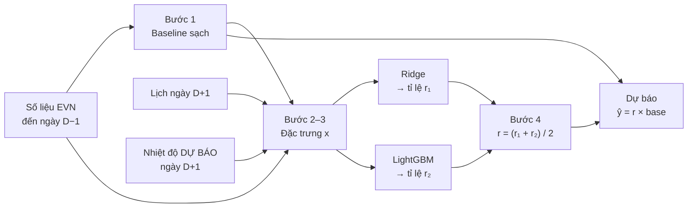
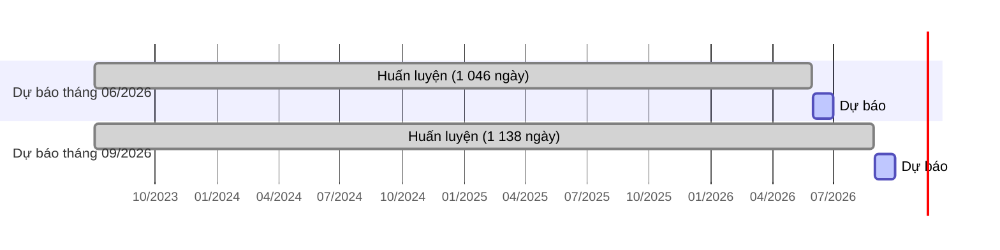
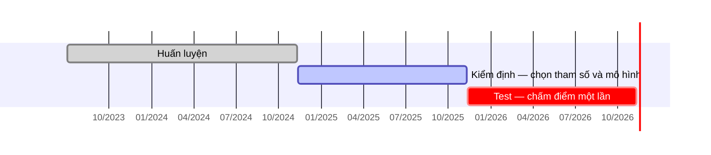

# Cách hoạt động của mô hình dự báo

Tài liệu giải thích **từng bước** mô hình biến dữ liệu thành một con số dự báo: thuật toán, công thức, và **hai ví dụ tính tay trên ngày thật** của tập test. Các con số trong ví dụ được tính lại bằng đúng mô hình đã dùng trong backtest, và **khớp với `data/backtest.csv`**.

Kết quả tổng hợp và đánh giá: [`Model.md`](Model.md). Mã nguồn: [`features.py`](../features.py), [`train.py`](../train.py).

> **Cách xem:** công thức viết bằng ký hiệu toán học (LaTeX), sơ đồ viết bằng Mermaid.
> - **Trên GitHub:** hiển thị đầy đủ cả công thức và sơ đồ.
> - **Trong VS Code:** nhấn `Ctrl+Shift+V` để mở bản xem trước. Công thức hiển thị sẵn; để xem sơ đồ, cài extension *Markdown Preview Mermaid Support*.

## Mục lục

1. [Tổng quan quy trình](#1-tổng-quan-quy-trình)
2. [Bước 1: Baseline sạch](#2-bước-1-baseline-sạch)
3. [Bước 2: Biến mục tiêu dạng tỉ lệ](#3-bước-2-biến-mục-tiêu-dạng-tỉ-lệ)
4. [Bước 3: Đặc trưng đầu vào](#4-bước-3-đặc-trưng-đầu-vào)
5. [Thuật toán 1: Hồi quy Ridge](#5-thuật-toán-1-hồi-quy-ridge)
6. [Thuật toán 2: LightGBM](#6-thuật-toán-2-lightgbm)
7. [Bước 4: Kết hợp và đổi về MW](#7-bước-4-kết-hợp-và-đổi-về-mw)
8. [Ví dụ 1: Ngày nắng nóng 24/06/2026](#8-ví-dụ-1-ngày-nắng-nóng-24062026)
9. [Ví dụ 2: Ngày lễ Quốc khánh 02/09/2026](#9-ví-dụ-2-ngày-lễ-quốc-khánh-02092026)
10. [Huấn luyện: walk-forward](#10-huấn-luyện-walk-forward)
11. [Chọn tham số và chọn mô hình](#11-chọn-tham-số-và-chọn-mô-hình)
12. [Cách đo sai số và kiểm định](#12-cách-đo-sai-số-và-kiểm-định)
13. [Khoảng dự báo](#13-khoảng-dự-báo)

### Bảng ký hiệu

| Ký hiệu | Ý nghĩa |
|---|---|
| $t$ | Ngày cần dự báo |
| $y(t)$ | Giá trị thực tế ngày $t$ (Pmax tính bằng MW, hoặc sản lượng tính bằng triệu kWh) |
| $\hat{y}(t)$ | Giá trị dự báo cho ngày $t$ |
| $\text{base}(t)$ | Baseline sạch của ngày $t$ |
| $r(t)$, $\hat{r}(t)$ | Tỉ lệ thực tế và tỉ lệ dự báo so với baseline |
| $x_j$, $z_j$ | Đặc trưng thứ $j$; và giá trị đã chuẩn hóa của nó |
| $\beta_j$ | Hệ số của Ridge |
| $h_m$ | Cây quyết định thứ $m$ của LightGBM |

---

## 1. Tổng quan quy trình

**Mục tiêu:** trong ngày $D$, dự báo Pmax và sản lượng của **ngày $D+1$**. Lúc đó EVN mới công bố số liệu đến ngày $D-1$, nên số liệu mới nhất cách ngày cần dự báo **2 ngày**.

| Biến mục tiêu | Mô hình cuối | Tỉ lệ dự báo |
|---|---|---|
| Pmax | **Ensemble** | $\hat{r} = \tfrac{1}{2}\left(\hat{r}_{\text{Ridge}} + \hat{r}_{\text{LightGBM}}\right)$ |
| Sản lượng | **Ridge** | $\hat{r} = \hat{r}_{\text{Ridge}}$ |

> **Ý tưởng chính:** mô hình không dự báo trực tiếp MW, mà trả lời câu hỏi *"ngày mai sẽ cao hơn hay thấp hơn mức bình thường bao nhiêu phần trăm?"*

---

## 2. Bước 1: Baseline sạch

### Công thức

$$
\text{base}(t) \;=\; \frac{1}{4} \sum_{k \,\in\, K_t} y(t - 7k)
$$

trong đó $K_t$ là **4 giá trị $k$ nhỏ nhất** trong $\{1, 2, \dots, 8\}$ sao cho ngày $t-7k$:

- ✔ có số liệu (không thiếu, không bị cờ lỗi `qc_same_as_adjacent`),
- ✔ **không** phải ngày lễ, và **không** nằm trong ±10 ngày quanh Mùng 1 Tết.

Cần ít nhất 2 ngày hợp lệ; nếu không thì ngày đó không được dự báo.

### Ba lý do thiết kế

| Thiết kế | Lý do |
|---|---|
| Lấy các ngày $t-7, t-14, \dots$ (**cùng thứ**) | Chủ nhật thấp hơn ngày thường khoảng 13%. So thứ Tư với thứ Tư thì hiệu ứng thứ trong tuần tự triệt tiêu |
| **Bỏ qua ngày lễ/Tết** (gọi là "sạch") | Nếu tuần trước có lễ, baseline thông thường bị kéo thấp và dự báo ngày thường sau đó sẽ sai |
| Chỉ dùng ngày $\le t-7$ | Luôn có sẵn lúc dự báo (độ trễ tối thiểu là 2 ngày), và tự cập nhật theo xu hướng tăng của phụ tải |

---

## 3. Bước 2: Biến mục tiêu dạng tỉ lệ

| Khi huấn luyện: tính tỉ lệ thực tế | Khi dự báo: đổi tỉ lệ về MW |
|:---:|:---:|
| $r(t) = \dfrac{y(t)}{\text{base}(t)}$ | $\hat{y}(t) = \hat{r}(t) \times \text{base}(t)$ |

| $r$ | Nghĩa |
|---|---|
| $1{,}00$ | Ngày mai bằng mức bình thường của 4 tuần trước |
| $1{,}05$ | Cao hơn 5% (ví dụ trời nóng hơn) |
| $0{,}75$ | Thấp hơn 25% (ví dụ ngày lễ) |

**Vì sao không dự báo trực tiếp MW?** Phụ tải năm 2026 cao hơn mọi năm trước (tăng khoảng 7,5%/năm). Mô hình cây (LightGBM) **không dự báo được giá trị lớn hơn những gì đã thấy** khi huấn luyện. Còn tỉ lệ $r$ luôn dao động quanh 1 ở mọi năm, nên mô hình học được quy luật dùng chung cho cả giai đoạn.

---

## 4. Bước 3: Đặc trưng đầu vào

Mỗi ngày cần dự báo được mô tả bằng **27 con số**. Mọi số liệu EVN đều lấy từ ngày $\le t-2$.

### 4.1. Lịch của ngày $t$ (biết trước)

| Đặc trưng | Cách tính |
|---|---|
| `dow` | Thứ trong tuần: $0$ = T2, …, $6$ = CN |
| `is_holiday` | $1$ nếu là ngày lễ / nghỉ bù / nghỉ hoán đổi, ngược lại $0$ |
| `off_block_len` | Số ngày của kỳ nghỉ liên tiếp chứa ngày $t$ ($0$ nếu đi làm) |
| `is_pre_day_off`, `is_post_day_off` | Ngày làm việc ngay trước / ngay sau kỳ nghỉ |
| `is_makeup_workday` | Thứ Bảy/CN phải đi làm bù |
| `tet_offset` | Số ngày so với Mùng 1 Tết, giữ trong khoảng $[-10, 15]$; ngoài khoảng gán $99$ |
| `doy_sin`, `doy_cos` | $\sin\!\left(\dfrac{2\pi \cdot \text{doy}}{365{,}25}\right)$ và $\cos\!\left(\dfrac{2\pi \cdot \text{doy}}{365{,}25}\right)$, với doy là thứ tự ngày trong năm (1–366). Biểu diễn vị trí trong năm dạng vòng tròn, để 31/12 và 01/01 nằm cạnh nhau |

### 4.2. Độ lệch gần đây (từ số liệu EVN)

| Đặc trưng | Công thức | Ý nghĩa |
|---|---|---|
| `ratio_lag2` | $r(t-2) = \dfrac{y(t-2)}{\text{base}(t-2)}$ | Ngày gần nhất có số liệu đang cao hay thấp so với bình thường. Bỏ trống nếu $t-2$ là ngày lễ/Tết |
| `ratio_mean_2_8` | $\dfrac{1}{7}\displaystyle\sum_{k=2}^{8} r(t-k)$ | Xu hướng của tuần gần nhất (chỉ tính ngày thường) |
| `base_growth_4w` | $\dfrac{\text{base}(t)}{\text{base}(t-28)} - 1$ | Mức nền đang tăng nhanh hay chậm |

### 4.3. Nhiệt độ dự báo, cho mỗi miền $\text{m} \in \{\text{hn}, \text{dn}, \text{hcm}\}$

Ký hiệu $T^{\text{fc}}_{\text{m}}(t)$ là Tmax **dự báo** của ngày $t$, $T^{\text{obs}}_{\text{m}}$ là Tmax **thực tế** của ngày tham chiếu, và $K_t$ là 4 ngày tham chiếu của baseline (mục 2).

| Đặc trưng | Công thức |
|---|---|
| `fc_tmax_m`, `fc_tmean_m` | Nhiệt độ cao nhất / trung bình **dự báo** của ngày $t$ |
| `hot_m` | $\max\!\left(0,\; T^{\text{fc}}_{\text{m}}(t) - 30\right)$ |
| `dtmax_m` | $T^{\text{fc}}_{\text{m}}(t) \;-\; \dfrac{1}{4}\displaystyle\sum_{k \in K_t} T^{\text{obs}}_{\text{m}}(t-7k)$ |
| `dhot_m` | $\texttt{hot\_m}(t) \;-\; \dfrac{1}{4}\displaystyle\sum_{k \in K_t} \max\!\left(0,\; T^{\text{obs}}_{\text{m}}(t-7k) - 30\right)$ |

> **Vì sao ngưỡng 30°C?** EDA (câu 4) cho thấy phụ tải gần như không đổi khi Tmax dưới 30°C, và tăng mạnh khi vượt 30°C.
>
> **Vì sao cần `dtmax` và `dhot`?** Mô hình dự báo tỉ lệ so với baseline. Nếu 4 ngày tham chiếu cũng nóng như ngày mai thì baseline đã "chứa" sẵn ảnh hưởng nắng nóng. Điều quan trọng là ngày mai **nóng hơn hay mát hơn các ngày tham chiếu** bao nhiêu.

---

## 5. Thuật toán 1: Hồi quy Ridge

### 5.1. Mô hình

Tỉ lệ dự báo bằng một hằng số cộng **tổng có trọng số** của các đặc trưng:

$$
\hat{r} \;=\; \beta_0 + \sum_{j=1}^{p} \beta_j \, z_j,
\qquad\qquad
z_j = \frac{x_j - \mu_j}{\sigma_j}
$$

- $p$: số đặc trưng; $x_j$: giá trị gốc của đặc trưng $j$; $z_j$: giá trị đã chuẩn hóa.
- $\mu_j$, $\sigma_j$: trung bình và độ lệch chuẩn của đặc trưng $j$ trên tập huấn luyện. Chuẩn hóa giúp các hệ số $\beta_j$ so sánh được với nhau dù đặc trưng có đơn vị khác nhau (°C, số ngày, tỉ lệ).
- Tích $\beta_j z_j$ là **đóng góp** của đặc trưng $j$ vào dự báo.

### 5.2. Cách tìm hệ số

Ridge chọn các hệ số $\beta$ làm nhỏ nhất:

$$
\min_{\beta}\;
\underbrace{\sum_{i=1}^{n} \left(r_i - \hat{r}_i\right)^2}_{(1)}
\;+\;
\underbrace{\alpha \sum_{j=1}^{p} \beta_j^2}_{(2)}
$$

- **(1)** Sai số trên tập huấn luyện ($n$ ngày): càng nhỏ càng khớp dữ liệu.
- **(2)** Phần phạt: hệ số càng lớn thì bị phạt càng nặng. $\alpha$ điều chỉnh mức phạt.

Bài toán có **nghiệm đóng**:

$$
\hat{\beta} = \left(Z^{\top} Z + \alpha I\right)^{-1} Z^{\top} \left(\mathbf{r} - \bar{r}\right),
\qquad
\beta_0 = \bar{r}
$$

| Giá trị $\alpha$ | Hành vi |
|---|---|
| $\alpha = 0$ | Hồi quy tuyến tính thông thường (bình phương nhỏ nhất) |
| $\alpha$ lớn | Hệ số bị kéo về gần 0: mô hình thận trọng hơn, ít học quá khớp hơn |
| **Đã chọn** | **Pmax $\alpha = 10$; sản lượng $\alpha = 1$** (trên tập kiểm định) |

Phần phạt đặc biệt cần thiết ở đây, vì nhiều đặc trưng **tương quan mạnh với nhau** (nhiệt độ 3 miền cùng tăng vào mùa hè). Không có phạt, các hệ số sẽ dao động rất lớn.

### 5.3. Mã hóa riêng cho Ridge

- `dow` → 6 biến 0/1: `dow_1`, …, `dow_6` (thứ Hai là mốc so sánh).
- `tet_offset` → 7 biến 0/1 theo nhóm ngày: $[-10,-8]$, $[-7,-4]$, $[-3,-1]$, $[0,3]$, $[4,6]$, $[7,10]$, $[11,15]$.
- Thêm `holiday_x_dow5`, `holiday_x_dow6`: ngày lễ rơi vào thứ Bảy / Chủ nhật.
- Giá trị thiếu (ví dụ `ratio_lag2` khi $t-2$ là ngày lễ) → điền bằng **trung vị** của tập huấn luyện.

### 5.4. Ưu, nhược điểm

| Ưu điểm | Nhược điểm |
|---|---|
| Dễ giải thích: mỗi hệ số là một con số | Chỉ học quan hệ tuyến tính (phải tự tạo `hot_m` để mô tả phi tuyến) |
| Ổn định với ít dữ liệu, kể cả ngày hiếm như lễ/Tết | Hệ số của các biến tương quan nhau khó diễn giải riêng lẻ (xem ví dụ 1) |
| Huấn luyện tức thì | |

---

## 6. Thuật toán 2: LightGBM

### 6.1. Ý tưởng: cộng dồn nhiều cây nhỏ

LightGBM xây **600 cây quyết định nhỏ nối tiếp nhau**. Mỗi cây sau học cách **sửa phần sai còn lại** của tất cả các cây trước:

$$
\begin{aligned}
F_0 &\approx 0{,}99 \\[4pt]
F_m(x) &= F_{m-1}(x) + \eta \cdot h_m(x), \qquad m = 1, 2, \dots, M \\[4pt]
\hat{r} &= F_M(x)
\end{aligned}
$$

| Ký hiệu | Ý nghĩa | Giá trị |
|---|---|---|
| $F_0$ | Giá trị khởi đầu: tỉ lệ điển hình của tập huấn luyện | ≈ 0,99 |
| $F_m$ | Dự báo sau khi đã cộng $m$ cây | |
| $h_m$ | Cây thứ $m$, mỗi lá chứa một con số điều chỉnh | tối đa **15 lá** |
| $\eta$ | Tốc độ học: mỗi cây chỉ sửa một phần nhỏ sai số | **0,03** |
| $M$ | Số cây | Pmax **600**, sản lượng **300** |

### 6.2. Mỗi cây học gì?

Ở bước $m$, với mỗi ngày $i$ trong tập huấn luyện, tính **phần sai còn lại** $g_i$:

| Hàm mất mát | Dùng cho | Phần sai còn lại $g_i$ | Giá trị tại mỗi lá |
|---|---|---|---|
| L2: $\;(r - F)^2$ | Sản lượng | $r_i - F_{m-1}(x_i)$ | **trung bình** phần sai của các ngày rơi vào lá |
| L1: $\;\lvert r - F \rvert$ | **Pmax** | $\operatorname{sign}\!\left(r_i - F_{m-1}(x_i)\right) = \pm 1$ | **trung vị** phần sai của các ngày rơi vào lá |

Cây được dựng sao cho các ngày có phần sai giống nhau rơi vào cùng một lá. Hàm **L1** (chọn cho Pmax) dùng trung vị nên **ít bị kéo lệch bởi ngày bất thường** hơn L2.

### 6.3. Cách dựng một cây

1. **Chia giá trị thành ô (histogram):** mỗi đặc trưng chia thành tối đa 255 khoảng; chỉ thử ngưỡng ở ranh giới các khoảng, nên rất nhanh.
2. **Mọc theo lá (leaf-wise):** mỗi bước chọn **lá và ngưỡng** giảm sai số nhiều nhất để chia đôi, ví dụ *"`is_holiday` ≤ 0,5?"* hay *"`dhot_hn` ≤ 1,8?"*. Dừng khi đủ 15 lá.
3. **Chống học quá khớp:** mỗi lá cần ít nhất 10 ngày; mỗi cây dùng ngẫu nhiên 90% số ngày và 90% số đặc trưng.
4. **Giá trị thiếu:** thuật toán tự học xem ngày thiếu giá trị nên đi nhánh nào.

### 6.4. Giải thích một dự báo: SHAP

Dự báo của LightGBM được tách thành đóng góp của từng đặc trưng (giá trị SHAP, có sẵn trong LightGBM):

$$
\hat{r} \;=\; \phi_0 \;+\; \sum_{j=1}^{p} \phi_j
$$

$\phi_0$ là giá trị gốc (dự báo khi chưa biết gì về ngày đó). $\phi_j > 0$: đặc trưng $j$ **đẩy dự báo lên**; $\phi_j < 0$: **kéo xuống**.

### 6.5. Ưu, nhược điểm

| Ưu điểm | Nhược điểm |
|---|---|
| Tự học quan hệ phi tuyến và tương tác (ví dụ "nóng **và** ngày thường") | Kém ở trường hợp hiếm (lễ/Tết), vì ít dữ liệu để chia nhánh |
| Xử lý giá trị thiếu tự động | Không ngoại suy (đã xử lý bằng cách dự báo tỉ lệ) |
| Tốt nhất ở ngày nắng nóng (MAPE 2,24%) | Khó giải thích hơn Ridge, cần SHAP |

---

## 7. Bước 4: Kết hợp và đổi về MW

| Biến | Tỉ lệ dự báo | Dự báo |
|---|:---:|:---:|
| **Pmax** | $\hat{r} = \dfrac{\hat{r}_{\text{Ridge}} + \hat{r}_{\text{LightGBM}}}{2}$ | $\hat{y} = \hat{r} \times \text{base}$ |
| **Sản lượng** | $\hat{r} = \hat{r}_{\text{Ridge}}$ | $\hat{y} = \hat{r} \times \text{base}$ |

**Vì sao lấy trung bình lại tốt hơn?** Hai mô hình **sai theo kiểu khác nhau**: Ridge tốt ở lễ/Tết, LightGBM tốt ở ngày nắng nóng. Khi một mô hình sai lệch, mô hình kia thường kéo lại.

| MAPE trên tập kiểm định | Ridge | LightGBM | Ensemble | Được chọn |
|---|---|---|---|---|
| Pmax | 2,34% | 2,37% | **2,25%** | Ensemble |
| Sản lượng | **2,20%** | 2,65% | 2,32% | Ridge |

---

## 8. Ví dụ 1: Ngày nắng nóng 24/06/2026

> **Thứ Tư 24/06/2026, ngày Pmax đạt kỷ lục: 57 536,7 MW.**
> Dự báo được lập ngày 23/06, khi EVN mới có số liệu đến hết 22/06.

### Bước 1: Baseline sạch

| Ngày tham chiếu | $k$ | Pmax thực tế (MW) | Lễ/Tết? | Dùng? |
|---|---|---|---|---|
| 17/06/2026 | 1 | 53 119,4 | Không | ✔ |
| 10/06/2026 | 2 | 48 962,3 | Không | ✔ |
| 03/06/2026 | 3 | 53 453,8 | Không | ✔ |
| 27/05/2026 | 4 | 57 189,4 | Không | ✔ |
| 20/05/2026 … | 5 … | | | (đã đủ 4 ngày) |

$$
\begin{aligned}
\text{base}
&= \frac{53\,119{,}4 + 48\,962{,}3 + 53\,453{,}8 + 57\,189{,}4}{4} \\[6pt]
&= \frac{212\,724{,}9}{4} \\[6pt]
&= \boxed{53\,181{,}2 \text{ MW}}
\end{aligned}
$$

Không tuần nào có lễ, nên ở đây baseline sạch trùng với baseline TB 4 tuần thông thường.

### Bước 2: Đặc trưng

**Độ lệch gần đây:**

$$
\texttt{ratio\_lag2} = \frac{y(22/06)}{\text{base}(22/06)} = \frac{53\,447{,}8}{54\,292{,}0} = 0{,}9845
$$

Ngày gần nhất có số liệu thấp hơn bình thường khoảng 1,5%.

**Nhiệt độ ở Hà Nội:** Tmax dự báo $36{,}7$°C; Tmax thực tế của 4 ngày tham chiếu là $33{,}9;\; 30{,}4;\; 35{,}0;\; 36{,}7$°C.

$$
\begin{aligned}
\texttt{hot\_hn} &= \max(0,\; 36{,}7 - 30) &&= 6{,}7 \\[6pt]
\texttt{dtmax\_hn} &= 36{,}7 - \frac{33{,}9 + 30{,}4 + 35{,}0 + 36{,}7}{4} = 36{,}7 - 34{,}0 &&= +2{,}7\,{}^{\circ}\text{C} \\[6pt]
\texttt{dhot\_hn} &= 6{,}7 - \frac{3{,}9 + 0{,}4 + 5{,}0 + 6{,}7}{4} = 6{,}7 - 4{,}0 &&= +2{,}7
\end{aligned}
$$

**Tổng hợp nhiệt độ 3 miền:**

| Miền | Tmax dự báo | `hot` | `dtmax` (so với ngày tham chiếu) |
|---|---|---|---|
| Hà Nội | 36,7°C | 6,7 | **+2,7°C** |
| Đà Nẵng | 39,6°C | 9,6 | **+3,75°C** |
| TP.HCM | 35,2°C | 5,2 | **+2,45°C** |

→ Ngày mai **nóng hơn các ngày tham chiếu khoảng 2,5–3,8°C ở cả 3 miền**, nên phụ tải dự kiến sẽ cao hơn baseline.

### Bước 3a: Ridge

Mô hình cho tháng 6/2026 được huấn luyện trên **1 046 ngày** (04/07/2023 → 30/05/2026).

**Một đóng góp tính tay**, đặc trưng `dhot_hn`:

$$
z = \frac{x - \mu}{\sigma} = \frac{2{,}70 - 0{,}363}{2{,}028} = 1{,}152
\qquad\Longrightarrow\qquad
\beta \cdot z = 0{,}0168 \times 1{,}152 = +0{,}0194
$$

Nghĩa là: riêng việc Hà Nội nóng hơn ngày tham chiếu đã đẩy dự báo lên **+1,94%**.

**Tổng hợp theo nhóm:**

| Nhóm đặc trưng | Đóng góp $\sum \beta_j z_j$ |
|---|---|
| Nhiệt độ | $+0{,}0431$ |
| Lịch | $+0{,}0168$ |
| Mùa trong năm | $-0{,}0091$ |
| Độ lệch gần đây | $-0{,}0258$ |
| **Tổng** | $\mathbf{+0{,}0250}$ |

$$
\hat{r}_{\text{Ridge}} = \underbrace{0{,}99030}_{\beta_0} + \underbrace{0{,}02500}_{\sum_j \beta_j z_j} = 1{,}01530
\qquad\Longrightarrow\qquad
1{,}01530 \times 53\,181{,}2 = 53\,995{,}1 \text{ MW}
$$

> **Lưu ý khi đọc hệ số Ridge.** Một vài đặc trưng nhiệt độ có hệ số **âm**: `hot_dn` ($\beta = -0{,}0065$, đóng góp $-0{,}0204$) và `fc_tmax_dn` ($\beta = -0{,}0063$, đóng góp $-0{,}0136$). Điều này nghe có vẻ vô lý (nóng hơn mà phụ tải giảm?). Nguyên nhân là `hot_dn`, `dhot_dn`, `fc_tmax_dn` **tương quan rất mạnh với nhau**, nên mô hình chia ảnh hưởng giữa chúng theo cách khó diễn giải riêng lẻ. **Chỉ nên đọc tổng của cả nhóm**: nhóm nhiệt độ đóng góp $+4{,}3\%$, đúng chiều trực giác.

### Bước 3b: LightGBM

Cùng tập huấn luyện 1 046 ngày, 600 cây, hàm mất mát L1.

**Dự báo được cộng dồn qua các cây** ($F_m$ sau $m$ cây):

| $m$ | 0 | 1 | 2 | 3 | 10 | 50 | 100 | 300 | 600 |
|---|---|---|---|---|---|---|---|---|---|
| $F_m$ | ≈ 0,99 | 1,0054 | 1,0066 | 1,0078 | 1,0140 | 1,0393 | 1,0532 | 1,0627 | **1,0619** |

Mỗi cây chỉ nhích dự báo lên một chút (vì $\eta = 0{,}03$); sau khoảng 300 cây thì gần như ổn định.

**Tách dự báo bằng SHAP:**

| Nhóm đặc trưng | $\sum \phi_j$ |
|---|---|
| Nhiệt độ | $+0{,}0792$ |
| Lịch | $+0{,}0128$ |
| Mùa trong năm | $-0{,}0046$ |
| Độ lệch gần đây | $-0{,}0162$ |
| **Tổng** | $\mathbf{+0{,}0713}$ |

Năm đặc trưng có ảnh hưởng lớn nhất: `fc_tmean_dn` $+0{,}0208$; `fc_tmean_hn` $+0{,}0191$; `base_growth_4w` $-0{,}0179$; `dhot_hn` $+0{,}0137$; `fc_tmax_hn` $+0{,}0095$.

$$
\hat{r}_{\text{LightGBM}} = \underbrace{0{,}99061}_{\phi_0} + \underbrace{0{,}07127}_{\sum \phi_j} = 1{,}06188
\qquad\Longrightarrow\qquad
1{,}06188 \times 53\,181{,}2 = 56\,472{,}0 \text{ MW}
$$

LightGBM đánh giá ảnh hưởng nắng nóng **mạnh gần gấp đôi** Ridge ($+7{,}9\%$ so với $+4{,}3\%$), vì nó học được quan hệ phi tuyến: càng nóng thì phụ tải tăng càng nhanh.

### Bước 4: Kết hợp và kết quả

$$
\begin{aligned}
\hat{r} &= \frac{1{,}01530 + 1{,}06188}{2} = 1{,}03859 \\[6pt]
\hat{y} &= 1{,}03859 \times 53\,181{,}2 = \boxed{55\,233{,}5 \text{ MW}} \\[6pt]
e &= \frac{\hat{y} - y}{y} = \frac{55\,233{,}5 - 57\,536{,}7}{57\,536{,}7} = -4{,}0\%
\end{aligned}
$$

($e$ là sai số tương đối: âm nghĩa là dự báo thấp hơn thực tế.)

| Cách dự báo | Dự báo (MW) | Thực tế (MW) | Sai số |
|---|---|---|---|
| Lấy số 2 ngày trước (22/06) | 53 447,8 | 57 536,7 | −7,1% |
| Baseline TB 4 tuần | 53 181,2 | 57 536,7 | −7,6% |
| Ridge | 53 995,1 | 57 536,7 | −6,2% |
| LightGBM | 56 472,0 | 57 536,7 | −1,9% |
| **Ensemble (mô hình cuối)** | **55 233,5** | 57 536,7 | **−4,0%** |

**Nhận xét:** mô hình nhận ra ngày mai nóng và nâng dự báo lên khoảng 2 050 MW so với baseline, giảm sai số từ −7,6% xuống −4,0%. Ngày kỷ lục vẫn cao hơn dự báo: đây là đợt nắng nóng cực đoan, thuộc nhóm ngày khó nhất. Khoảng P10–P90 của ngày này là 54 235 – 57 049 MW, và giá trị thực tế **nằm trên P90**, minh họa cho việc khoảng dự báo đang quá hẹp (`Model.md` mục 8).

---

## 9. Ví dụ 2: Ngày lễ Quốc khánh 02/09/2026

> **Thứ Tư 02/09/2026, ngày thứ 5 của kỳ nghỉ 5 ngày (29/08 → 02/09).**
> Pmax thực tế: **37 835,0 MW**.

### Bước 1: Baseline sạch

| Ngày tham chiếu | $k$ | Pmax (MW) | Dùng? |
|---|---|---|---|
| 26/08/2026 | 1 | 50 601,1 | ✔ |
| 19/08/2026 | 2 | 49 310,2 | ✔ |
| 12/08/2026 | 3 | 56 134,0 | ✔ |
| 05/08/2026 | 4 | 49 166,4 | ✔ |

$$
\text{base} = \frac{50\,601{,}1 + 49\,310{,}2 + 56\,134{,}0 + 49\,166{,}4}{4} = \frac{205\,211{,}7}{4} = \boxed{51\,302{,}9 \text{ MW}}
$$

Đây là mức của một **thứ Tư đi làm bình thường**. Nếu dùng nguyên baseline làm dự báo thì sai:

$$
\frac{51\,302{,}9 - 37\,835{,}0}{37\,835{,}0} = +35{,}6\%
$$

### Bước 2: Đặc trưng chính

| Đặc trưng | Giá trị | Ý nghĩa |
|---|---|---|
| `is_holiday` | **1** | Ngày lễ |
| `off_block_len` | **5** | Thuộc kỳ nghỉ dài 5 ngày |
| `ratio_lag2` | **trống** | Ngày $t-2$ (31/08) cũng là ngày nghỉ, nên không dùng làm thông tin "độ lệch gần đây" |
| Nhiệt độ | 33,7°C (HN) | Nóng hơn ngày tham chiếu khoảng 1,5°C ở HN, mát hơn 0,7°C ở ĐN |

### Bước 3: Hai mô hình

Huấn luyện trên **1 138 ngày** (04/07/2023 → 30/08/2026).

**Đóng góp của `is_holiday` trong Ridge, tính tay:**

$$
z = \frac{1 - 0{,}0343}{0{,}1819} = 5{,}31
\qquad\Longrightarrow\qquad
\beta \cdot z = -0{,}0305 \times 5{,}31 = -0{,}162
$$

$z$ rất lớn vì ngày lễ rất hiếm (chỉ khoảng 3,4% số ngày), nên khi `is_holiday` bằng 1 thì đóng góp của nó rất mạnh: một mình nó kéo dự báo xuống **16,2%**.

**So sánh hai mô hình theo nhóm:**

| | Ridge: $\sum \beta_j z_j$ | LightGBM: $\sum \phi_j$ |
|---|---|---|
| Giá trị gốc ($\beta_0$ / $\phi_0$) | $0{,}9908$ | $0{,}9913$ |
| **Lịch** | $\mathbf{-0{,}2135}$ | $\mathbf{-0{,}1943}$ |
| Nhiệt độ | $+0{,}0139$ | $+0{,}0007$ |
| Độ lệch gần đây | $-0{,}0033$ | $-0{,}0286$ |
| Mùa trong năm | $-0{,}0096$ | $-0{,}0072$ |
| **Tỉ lệ dự báo $\hat{r}$** | $\mathbf{0{,}7782}$ | $\mathbf{0{,}7619}$ |

Cả hai mô hình **cùng kết luận**: ngày lễ trong kỳ nghỉ dài làm phụ tải giảm khoảng 22–24%; nhiệt độ gần như không ảnh hưởng.

**LightGBM "nhận ra" ngày lễ dần dần qua các cây:**

| $m$ | 1 | 10 | 50 | 100 | 300 | 600 |
|---|---|---|---|---|---|---|
| $F_m$ | 1,0027 | 0,9946 | 0,8749 | 0,7920 | 0,7681 | **0,7619** |

Các cây đầu chưa phân biệt ngày lễ (dự báo vẫn quanh 1,0). Sau khoảng 50–100 cây, các nhánh chia theo `is_holiday` được cộng dồn và dự báo giảm mạnh.

### Bước 4: Kết quả

$$
\begin{aligned}
\hat{r} &= \frac{0{,}7782 + 0{,}7619}{2} = 0{,}7701 \\[6pt]
\hat{y} &= 0{,}7701 \times 51\,302{,}9 = \boxed{39\,506{,}7 \text{ MW}} \\[6pt]
e &= \frac{\hat{y} - y}{y} = \frac{39\,506{,}7 - 37\,835{,}0}{37\,835{,}0} = +4{,}4\%
\end{aligned}
$$

(Dương nghĩa là dự báo cao hơn thực tế.)

| Cách dự báo | Dự báo (MW) | Thực tế (MW) | Sai số |
|---|---|---|---|
| Baseline TB 4 tuần | 51 302,9 | 37 835,0 | **+35,6%** |
| Lấy số 2 ngày trước (31/08, cũng là ngày nghỉ) | 42 101,8 | 37 835,0 | +11,3% |
| Ridge | 39 926,2 | 37 835,0 | +5,5% |
| LightGBM | 39 087,2 | 37 835,0 | +3,3% |
| **Ensemble (mô hình cuối)** | **39 506,7** | 37 835,0 | **+4,4%** |

**Nhận xét:** đây là loại ngày baseline thất bại hoàn toàn. Nhờ các đặc trưng lịch, mô hình giảm sai số từ **35,6% xuống 4,4%**. Đó là lý do MAPE nhóm lễ/Tết giảm từ khoảng 24% xuống khoảng 5,7% (`Model.md` mục 7).

---

## 10. Huấn luyện: walk-forward

Mô hình **không được huấn luyện một lần rồi dùng mãi**. Backtest **huấn luyện lại vào đầu mỗi tháng**, chỉ bằng dữ liệu đã có tại thời điểm đó:

$$
\mathcal{T}_M \;=\; \big\{\, d \;:\; d_{\text{start}} \;\le\; d \;\le\; d_M - 2 \,\big\}
$$

- $\mathcal{T}_M$: tập các ngày dùng để huấn luyện mô hình dự báo cho tháng $M$.
- $d_{\text{start}}$ = 01/07/2023: ngày bắt đầu dữ liệu huấn luyện.
- $d_M$: ngày đầu tiên của tháng $M$; trừ 2 ngày vì độ trễ công bố số liệu.

**Vì sao trừ 2 ngày?** Dự báo đầu tiên của tháng 6 (cho 01/06) được lập ngày 31/05, lúc đó EVN mới có số liệu đến 30/05. Nếu cho mô hình học cả ngày 31/05 là dùng thông tin **chưa tồn tại** lúc dự báo (rò rỉ thông tin).

Ngày bắt đầu thực tế là 04/07/2023 (không phải 01/07), vì những ngày đầu chưa đủ dữ liệu quá khứ để tính baseline.

---

## 11. Chọn tham số và chọn mô hình

Dữ liệu được chia theo thời gian, **không xáo trộn**:

**Quy trình:**

1. Với mỗi bộ tham số (6 giá trị $\alpha$ của Ridge; 16 tổ hợp của LightGBM), chạy walk-forward trên **tập kiểm định**, tính MAPE.
2. Giữ bộ tham số có MAPE kiểm định nhỏ nhất.
3. So 3 ứng viên Ridge / LightGBM / Ensemble trên tập kiểm định, chọn mô hình cuối.
4. **Sau đó mới** chạy trên tập test, dùng đúng tham số và mô hình đã chọn.

Tập test không được dùng ở bất kỳ bước chọn lựa nào, nên kết quả test là ước lượng **trung thực** của độ chính xác khi dùng thật.

---

## 12. Cách đo sai số và kiểm định

### 12.1. Ba chỉ số sai số

Với $n$ ngày, $y_i$ là thực tế, $\hat{y}_i$ là dự báo:

$$
\text{MAPE} = \frac{100\%}{n} \sum_{i=1}^{n} \frac{\lvert \hat{y}_i - y_i \rvert}{y_i}
\qquad
\text{MAE} = \frac{1}{n} \sum_{i=1}^{n} \lvert \hat{y}_i - y_i \rvert
\qquad
\text{RMSE} = \sqrt{\frac{1}{n} \sum_{i=1}^{n} \left(\hat{y}_i - y_i\right)^2}
$$

| Chỉ số | Đơn vị | Ý nghĩa |
|---|---|---|
| **MAPE** (chỉ số chính) | % | Sai số phần trăm trung bình. MAPE 2% ≈ độ chính xác 98% |
| MAE | MW | Sai số trung bình tính bằng MW |
| RMSE | MW | Giống MAE nhưng phạt nặng các ngày sai nhiều |

**Ví dụ với hai ngày ở trên** (mô hình Ensemble):

| Ngày | $y$ | $\hat{y}$ | $\lvert \hat{y} - y \rvert$ | $\lvert \hat{y} - y \rvert / y$ |
|---|---|---|---|---|
| 24/06/2026 | 57 536,7 | 55 233,5 | 2 303,2 | 4,00% |
| 02/09/2026 | 37 835,0 | 39 506,7 | 1 671,7 | 4,42% |

$$
\begin{aligned}
\text{MAPE} &= \frac{4{,}00\% + 4{,}42\%}{2} = 4{,}21\% \\[6pt]
\text{MAE}  &= \frac{2\,303{,}2 + 1\,671{,}7}{2} = 1\,987{,}5 \text{ MW} \\[6pt]
\text{RMSE} &= \sqrt{\frac{2\,303{,}2^2 + 1\,671{,}7^2}{2}} = \sqrt{4\,049\,656} = 2\,012{,}4 \text{ MW}
\end{aligned}
$$

Hai ngày này đều khó (kỷ lục nắng nóng, ngày lễ). Trên toàn bộ 329 ngày test, MAPE là **2,12%**.

### 12.2. Kiểm định Diebold–Mariano

**Câu hỏi:** mô hình tốt hơn baseline **thật sự**, hay chỉ do may mắn với năm test này?

**Bước 1.** Chênh lệch sai số từng ngày giữa mô hình (1) và baseline (2):

$$
d_i = \frac{\lvert \hat{y}^{(1)}_i - y_i \rvert}{y_i} \;-\; \frac{\lvert \hat{y}^{(2)}_i - y_i \rvert}{y_i}
$$

**Bước 2.** Thống kê DM, có tính đến tương quan giữa sai số các ngày liền nhau (dự báo trước $h = 2$ ngày):

$$
\text{DM} = \frac{\bar{d}}{\sqrt{\hat{\sigma}^2_{\text{LR}} / n}},
\qquad
\hat{\sigma}^2_{\text{LR}} = \hat{\gamma}_0 + 2 \sum_{k=1}^{h-1} \left(1 - \frac{k}{h}\right) \hat{\gamma}_k
$$

với $\hat{\gamma}_k$ là hiệp phương sai mẫu của $d_i$ ở độ trễ $k$.

**Bước 3.** Hiệu chỉnh mẫu nhỏ (Harvey, Leybourne và Newbold, 1997), rồi so với phân phối $t$ với $n-1$ bậc tự do:

$$
\text{DM}^{*} = \text{DM} \cdot \sqrt{\frac{n + 1 - 2h + h(h-1)/n}{n}}
$$

| Kết quả | Kết luận |
|---|---|
| $\text{DM}^{*} < 0$ và $p < 0{,}05$ | Mô hình chính xác hơn baseline, **có ý nghĩa thống kê** |
| Pmax: $\text{DM}^{*} = -5{,}31$, $p < 0{,}0001$ | ✔ |
| Sản lượng: $\text{DM}^{*} = -5{,}69$, $p < 0{,}0001$ | ✔ |

---

## 13. Khoảng dự báo

Ngoài dự báo một con số, hai mô hình LightGBM phụ dự báo **phân vị 10%** và **phân vị 90%**, tạo thành khoảng P10–P90. Kỳ vọng: khoảng **80%** số ngày, giá trị thực tế nằm trong khoảng này.

Mô hình phân vị dùng **hàm mất mát pinball** thay cho L1/L2:

$$
L_{\tau}(y, q) =
\begin{cases}
\tau \,(y - q), & y \ge q \\[4pt]
(1 - \tau)\,(q - y), & y < q
\end{cases}
$$

- $q$: giá trị phân vị mà mô hình dự báo; $\tau$: mức phân vị (0,1 hoặc 0,9).
- Dòng trên ($y \ge q$): dự báo **thấp hơn** thực tế. Dòng dưới ($y < q$): dự báo **cao hơn** thực tế.

Với $\tau = 0{,}9$: dự báo thấp hơn thực tế bị phạt **nặng gấp 9 lần** dự báo cao hơn ($0{,}9$ so với $0{,}1$). Mô hình vì vậy đẩy $q$ lên cao, sao cho chỉ khoảng 10% số ngày vượt $q$.

> **Hạn chế đã biết:** trên tập test, khoảng P10–P90 chỉ chứa **64–66%** số ngày, thay vì 80% (`Model.md` mục 8). Ví dụ 1 là một trường hợp thực tế nằm ngoài khoảng. Cần hiệu chỉnh (conformal prediction) trước khi sử dụng.
