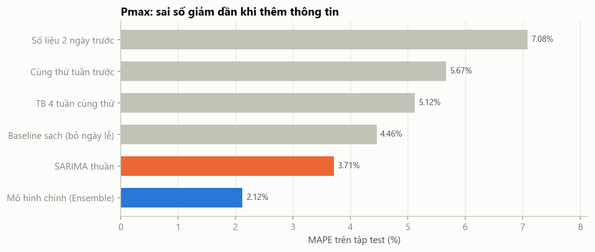
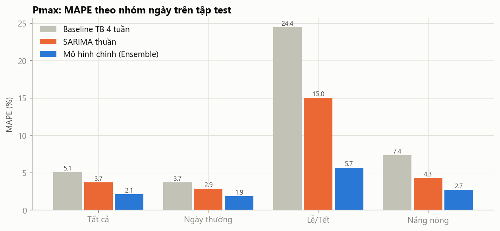
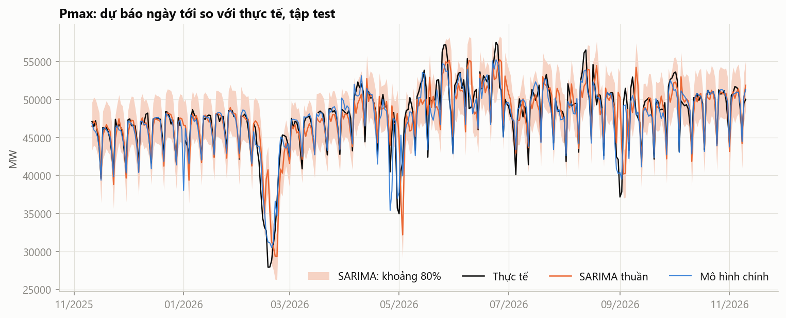
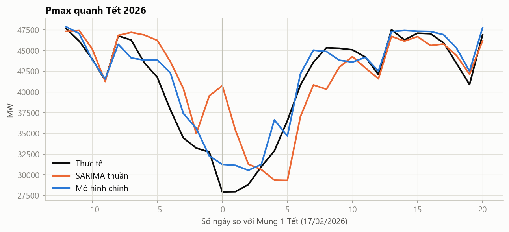
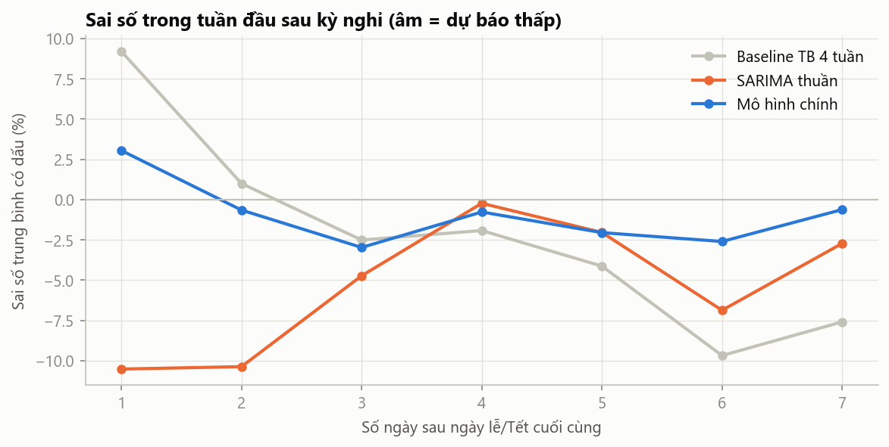

# So sánh hai phương pháp: SARIMA thuần và mô hình chính

Tài liệu đặt cạnh nhau hai phương pháp dự báo **Pmax ngày tới**, đánh giá trên **cùng một năm test** (11/11/2025 → 10/11/2026), **cùng 329 ngày**, cùng quy trình walk-forward:

- **Mô hình chính:** Ensemble Ridge + LightGBM, dự báo tỉ lệ so với baseline sạch, dùng lịch sử Pmax, lịch và nhiệt độ dự báo. Báo cáo: [`Model.md`](Model.md); thuật toán: [`Algorithm.md`](Algorithm.md).
- **SARIMA thuần:** SARIMA(2,0,1)(1,1,1)₇, chỉ dùng lịch sử Pmax. Báo cáo: [`SARIMA.md`](SARIMA.md); thuật toán: [`SARIMA_Algorithm.md`](SARIMA_Algorithm.md).

## Tóm tắt

| | SARIMA thuần | Mô hình chính | Bên tốt hơn |
|---|---|---|---|
| **MAPE (tất cả)** | 3,71% | **2,12%** | Mô hình chính, sai số thấp hơn **43%** |
| Ngày thường | 2,90% | **1,86%** | Mô hình chính |
| Lễ/Tết | 15,04% | **5,71%** | Mô hình chính, thấp hơn **2,6 lần** |
| Nắng nóng | 4,30% | **2,71%** | Mô hình chính |
| MAE / RMSE (MW) | 1 684 / 2 647 | **993 / 1 368** | Mô hình chính |
| Ngày sai trên 5% | 22,2% | **6,1%** | Mô hình chính |
| **Khoảng dự báo 80%: độ phủ** | **86,1%** | 66,3% | **SARIMA** |
| Dữ liệu cần | **Chỉ Pmax** | Pmax + lịch + thời tiết dự báo | **SARIMA** (đơn giản hơn) |
| Kiểm định Diebold–Mariano | | | Mô hình chính tốt hơn, **p < 0,0001** |

**Kết luận:** mô hình chính chính xác hơn rõ rệt ở **mọi nhóm ngày**, và sự khác biệt có ý nghĩa thống kê. SARIMA chỉ hơn ở **độ tin cậy của khoảng dự báo** và ở chỗ **cần ít dữ liệu hơn**.

---

## 1. Hai cách tiếp cận

| | SARIMA thuần | Mô hình chính |
|---|---|---|
| **Câu hỏi mô hình trả lời** | "Chuỗi Pmax tự lặp lại thế nào theo ngày và theo tuần?" | "Ngày mai cao/thấp hơn mức bình thường bao nhiêu, căn cứ vào lịch, thời tiết và diễn biến gần đây?" |
| **Đầu vào** | Lịch sử Pmax | Lịch sử Pmax, lịch (lễ, Tết, thứ), nhiệt độ dự báo 3 miền: 27 đặc trưng |
| **Xử lý xu hướng tăng** | Sai phân mùa: so với cùng thứ tuần trước | Dự báo tỉ lệ so với baseline sạch (4 tuần cùng thứ, bỏ ngày lễ) |
| **Thuật toán** | Mô hình tuyến tính trên chuỗi thời gian, ước lượng bằng hợp lý cực đại (bộ lọc Kalman) | Hồi quy Ridge (tuyến tính) + LightGBM (600 cây quyết định), lấy trung bình |
| **Số tham số học** | 5 (+ phương sai nhiễu) | Ridge: khoảng 40 hệ số; LightGBM: 600 cây × tối đa 15 lá |
| **Chọn cấu hình** | 72 bậc (p, d, q, P, Q), theo MAPE tập kiểm định | 6 giá trị α (Ridge), 16 tổ hợp LightGBM, 3 ứng viên mô hình cuối, theo MAPE tập kiểm định |
| **Thời gian chạy toàn bộ** (chọn cấu hình + backtest) | Khoảng 20–25 phút (chỉ Pmax) | Khoảng 2 phút (cho cả Pmax và sản lượng) |
| **Khoảng dự báo** | Từ lý thuyết mô hình (phân phối chuẩn) | LightGBM phân vị (quantile), chưa hiệu chỉnh |
| **Giải thích được** | Phương trình sai phân với 5 hệ số | Hệ số Ridge và giá trị SHAP của LightGBM |

Cả hai dùng chung: dữ liệu từ 01/07/2023, loại 12 ngày bị cờ trùng số liệu, dự báo 2 bước (dữ liệu đến t−2), walk-forward huấn luyện lại hằng tháng, chọn cấu hình trên năm kiểm định 11/11/2024 → 10/11/2025.

---

## 2. Độ chính xác

### 2.1. Bậc thang sai số

| Bước | MAPE | Giảm so với bước trước | Thông tin được thêm |
|---|---|---|---|
| Số liệu 2 ngày trước | 7,08% | | Chỉ ngày gần nhất |
| Cùng thứ tuần trước | 5,67% | −1,41 | Chu kỳ tuần |
| TB 4 tuần cùng thứ | 5,12% | −0,55 | Trung bình để giảm nhiễu |
| Baseline sạch | 4,46% | −0,66 | Bỏ ngày lễ khỏi tuần tham chiếu |
| **SARIMA thuần** | **3,71%** | −0,75 | Quán tính ngắn hạn và cấu trúc tự tương quan, chỉ từ chuỗi Pmax |
| **Mô hình chính** | **2,12%** | **−1,59** | **Lịch (lễ, Tết) và nhiệt độ dự báo** |

**Đọc bảng:** bước nhảy lớn nhất (−1,59 điểm) đến từ việc thêm **thông tin bên ngoài chuỗi**: lịch và thời tiết. Khai thác tối đa lịch sử Pmax bằng SARIMA chỉ giúp thêm 0,75 điểm so với baseline sạch, và phần cải thiện này **chưa có ý nghĩa thống kê** (p = 0,066).

### 2.2. Theo nhóm ngày

| Nhóm ngày | Số ngày | SARIMA | Mô hình chính | Chênh lệch |
|---|---|---|---|---|
| Ngày thường | 307 | 2,90% | 1,86% | −1,04 |
| Lễ/Tết | 22 | 15,04% | 5,71% | **−9,33** |
| Nắng nóng (top 10% Tmax) | 33 | 4,30% | 2,71% | −1,59 |

Nhóm lễ/Tết chỉ có 22 ngày, nên con số của nhóm này dao động nhiều hơn các nhóm khác. Nhóm nắng nóng có thể trùng với ngày thường.

Khoảng cách lớn nhất ở **lễ/Tết**: SARIMA không biết lịch, còn mô hình chính có đặc trưng lịch. Ngay cả ngày thường, mô hình chính cũng tốt hơn khoảng 1 điểm, nhờ baseline sạch ổn định hơn và nhờ nhiệt độ.

### 2.3. Kiểm định thống kê

Diebold–Mariano (h = 2, hiệu chỉnh Harvey–Leybourne–Newbold), SARIMA so với mô hình chính trên 329 ngày: **DM = +5,21, p < 0,0001**. Mô hình chính chính xác hơn, và khác biệt **không phải do ngẫu nhiên**.

### 2.4. Phân bố sai số

| Sai số nhỏ hơn | SARIMA | Mô hình chính |
|---|---|---|
| 1% | 26,4% số ngày | 35,0% |
| 2% | 48,3% | 60,2% |
| 3% | 63,2% | 76,6% |
| **5%** | **77,8%** | **93,9%** |

Với SARIMA, cứ khoảng **5 ngày có 1 ngày sai trên 5%**. Với mô hình chính, khoảng **16 ngày mới có 1 ngày**.

### 2.5. Theo tháng

MAPE (%) trên cùng tập ngày:

| Tháng | SARIMA | Mô hình chính | Ghi chú |
|---|---|---|---|
| 11/2025 | 1,58 | 0,94 | |
| 12/2025 | 1,49 | 1,10 | |
| 01/2026 | 1,35 | 1,09 | Mùa đông ổn định: hai mô hình gần nhau |
| **02/2026** | **10,07** | 3,89 | Tết |
| 03/2026 | 1,81 | 1,26 | |
| 04/2026 | 4,05 | 3,18 | Giỗ Tổ, 30/4 |
| **05/2026** | **6,62** | 3,79 | 1/5, nắng nóng đầu mùa |
| 06/2026 | 4,15 | 2,13 | Nắng nóng |
| 07/2026 | 2,97 | 2,27 | |
| 08/2026 | 3,98 | 2,11 | Nắng nóng |
| **09/2026** | **5,62** | 2,33 | Quốc khánh |
| 10/2026 | 1,96 | 1,43 | |
| 11/2026 | 1,85 | 1,24 | |

Mô hình chính tốt hơn ở **cả 13 tháng**. Hai mô hình gần nhau nhất vào mùa đông không có lễ (11/2025 → 01/2026), xa nhau nhất ở các tháng có kỳ nghỉ hoặc nắng nóng.

---

## 3. Hành vi trong các tình huống khó

### 3.1. Ngày lễ và Tết

| | SARIMA | Mô hình chính |
|---|---|---|
| MAPE Tết 2026 (−10 → +15 ngày) | 9,07% | **4,13%** |
| Ngày lễ chính (ví dụ 02/09/2026) | +15,3% | **+4,4%** |
| Cơ chế | Không biết ngày lễ. Chỉ giảm dự báo khi **đã thấy** số liệu giảm, chậm 2 ngày | Biết trước ngày lễ, độ dài kỳ nghỉ và số ngày so với Tết |

SARIMA vẽ lại được hình chữ V của Tết nhưng **trễ khoảng 2 ngày**. Mô hình chính bắt đúng thời điểm.

### 3.2. Ngày làm việc ngay sau kỳ nghỉ

| Ngày sau kỳ nghỉ | SARIMA (sai số TB có dấu) | Mô hình chính |
|---|---|---|
| 1 | **−10,5%** | +3,1% |
| 2 | **−10,4%** | −0,7% |
| 3 | −4,7% | −3,0% |

SARIMA có **"dư âm"**: mang mức phụ tải thấp của ngày nghỉ sang ngày đi làm. Ví dụ 04/09/2026: SARIMA sai **−21,7%**, mô hình chính sai −4,3%. Mô hình chính không mắc lỗi này, vì nó biết hôm đó là ngày làm việc. Ngoài ra, đặc trưng `ratio_lag2` của nó **bỏ qua ngày lễ** khi đo "độ lệch gần đây".

### 3.3. Nắng nóng

| | SARIMA | Mô hình chính |
|---|---|---|
| MAPE nhóm nắng nóng | 4,30% | **2,71%** |
| Ngày kỷ lục 24/06/2026 | −8,2% | **−4,0%** |
| Cơ chế | Không biết nhiệt độ. MA mùa còn **rút lại** mức tăng của tuần trước | Biết nhiệt độ dự báo ngày mai cao hơn các ngày tham chiếu bao nhiêu |

### 3.4. Những ngày sai nhiều nhất của mỗi mô hình

| Mô hình | Ngày sai nhiều nhất | Sai số | Kiểu lỗi |
|---|---|---|---|
| SARIMA | 17/02/2026 (Mùng 1 Tết) | +46,0% | Không biết ngày nghỉ |
| SARIMA | 01/09/2026 (Quốc khánh) | +35,3% | Không biết ngày nghỉ |
| SARIMA | 03/05/2026 (2 ngày sau kỳ nghỉ) | −23,2% | Dư âm sau kỳ nghỉ |
| Mô hình chính | 27/04/2026 (nghỉ bù Giỗ Tổ) | −17,0% | Coi ngày nghỉ bù như ngày lễ chính |
| Mô hình chính | 26/04/2026 (Giỗ Tổ rơi vào CN) | −12,5% | Trừ hai lần (lễ + Chủ nhật) |
| Mô hình chính | 17/02/2026 (Mùng 1 Tết) | +11,9% | Đáy Tết sâu hơn mức đã học |

Lỗi lớn nhất của SARIMA là **không biết lịch** (sai 20–46%). Lỗi lớn nhất của mô hình chính là **biết lịch nhưng hiểu chưa đúng một số loại ngày nghỉ đặc biệt** (sai 12–17%).

---

## 4. Khoảng dự báo

| | SARIMA | Mô hình chính |
|---|---|---|
| Phương pháp | Công thức lý thuyết $\hat y \pm 1{,}2816 \cdot \text{sd}$ | LightGBM phân vị 0,1 và 0,9 |
| Độ phủ thực tế (kỳ vọng 80%) | **86,1%** | 66,3% |
| Thực tế dưới P10 / trên P90 | 7,0% / 7,0% | 12,3% / 21,4% |
| Độ rộng trung bình | 13,3% của Pmax | 5,9% của Pmax |
| Đánh giá | **Đáng tin cậy**, hơi rộng, cân đối hai phía | **Quá hẹp**, lệch về phía dưới |

Đây là điểm duy nhất SARIMA vượt mô hình chính. Khoảng của SARIMA rộng nhưng trung thực. Khoảng của mô hình chính hẹp hơn nhưng **tự tin quá mức**, cần hiệu chỉnh (đề xuất conformal prediction trong [`Model.md`](Model.md) mục 11) trước khi dùng.

---

## 5. Ưu và nhược điểm

| | SARIMA thuần | Mô hình chính |
|---|---|---|
| **Ưu điểm** | Chỉ cần một chuỗi số liệu | Chính xác hơn ở mọi nhóm ngày |
| | Lý thuyết chuẩn mực, quen thuộc trong giáo trình | Xử lý tốt lễ, Tết, nắng nóng |
| | Khoảng dự báo đáng tin cậy | Không có hiệu ứng "dư âm" sau kỳ nghỉ |
| | Tự xử lý ngày thiếu (Kalman) | Chạy nhanh, dễ mở rộng thêm đặc trưng |
| **Nhược điểm** | Không biết lịch và thời tiết | Cần thêm dữ liệu lịch và thời tiết dự báo |
| | Phản ứng chậm 2 ngày với mọi thay đổi | Khoảng dự báo chưa đáng tin cậy |
| | Tham số không ổn định giữa các tháng | Sai với một số loại ngày nghỉ đặc biệt (nghỉ bù) |
| | Chạy lâu hơn khoảng 10 lần | Nhiều thành phần hơn, phức tạp hơn khi giải thích |

---

## 6. Nên dùng phương pháp nào?

| Mục đích | Khuyến nghị |
|---|---|
| **Dự báo vận hành hằng ngày** | **Mô hình chính**: sai số thấp hơn 43%, đặc biệt ở các ngày rủi ro cao (lễ, Tết, nắng nóng) |
| Cần khoảng dự báo ngay | SARIMA cho khoảng đáng tin cậy hơn; hoặc hiệu chỉnh khoảng của mô hình chính trước khi dùng |
| Không có dữ liệu thời tiết/lịch | SARIMA là lựa chọn hợp lý, nhưng nên **thủ công điều chỉnh** các ngày lễ |
| Mốc so sánh trong báo cáo khoa học | SARIMA: phương pháp chuẩn để chứng minh mô hình mới thực sự có giá trị |

## 7. Kết luận

1. Trên một năm test độc lập, **mô hình chính (MAPE 2,12%) chính xác hơn SARIMA thuần (3,71%)** ở mọi nhóm ngày và mọi tháng, có ý nghĩa thống kê (p < 0,0001).
2. Phần chênh lệch đến chủ yếu từ **thông tin bên ngoài chuỗi Pmax**. Riêng ở lễ/Tết, sai số giảm từ 15,0% xuống 5,7%.
3. SARIMA cho thấy **giới hạn của việc chỉ nhìn vào quá khứ**: mọi thay đổi do lịch hay thời tiết chỉ được nhận ra sau 2 ngày, gây sai số lớn trong và ngay sau kỳ nghỉ.
4. SARIMA có giá trị ở **khoảng dự báo đáng tin cậy** (phủ 86%), một gợi ý cho việc hiệu chỉnh khoảng dự báo của mô hình chính.
5. Hướng mở rộng tự nhiên cho SARIMA là **SARIMAX** (thêm biến lịch và nhiệt độ). Khi đó khoảng cách với mô hình chính sẽ thu hẹp, nhưng hướng này **chưa được thực hiện** trong phạm vi dự án.
