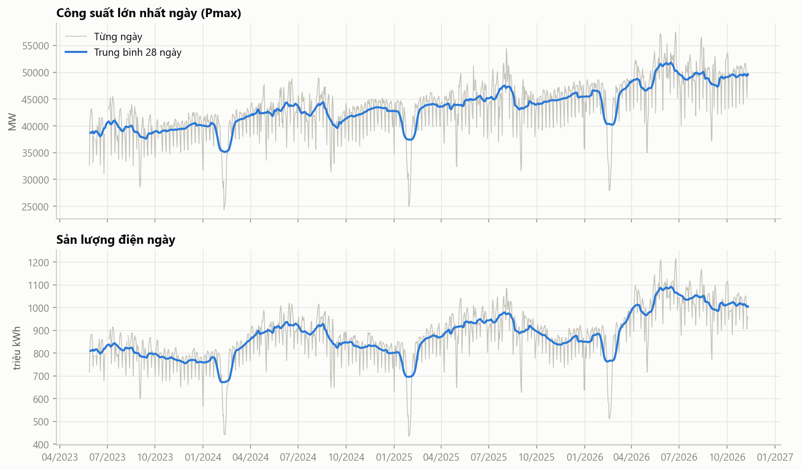
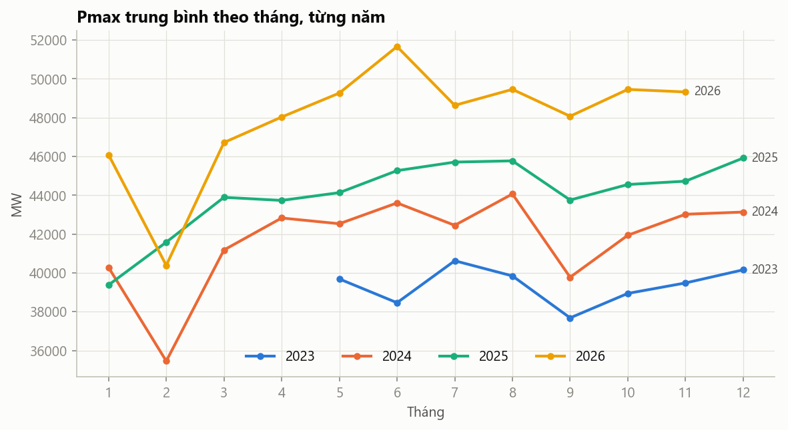
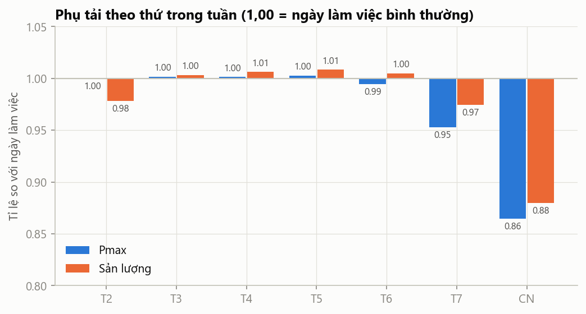
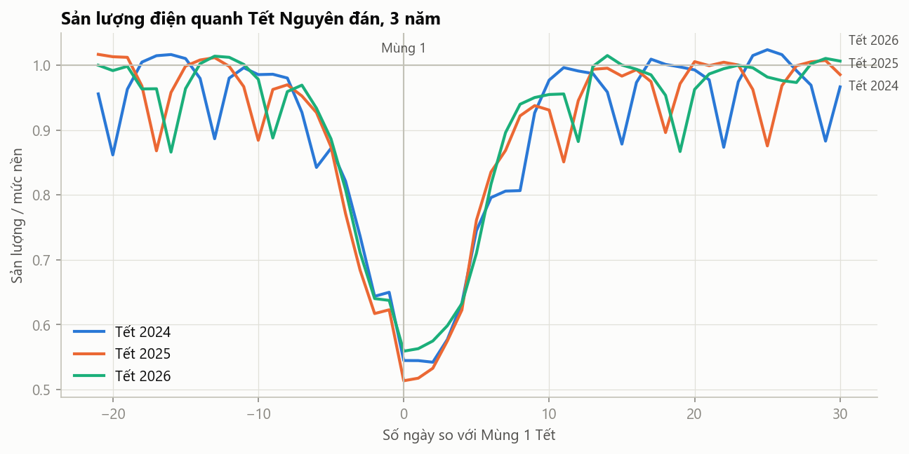
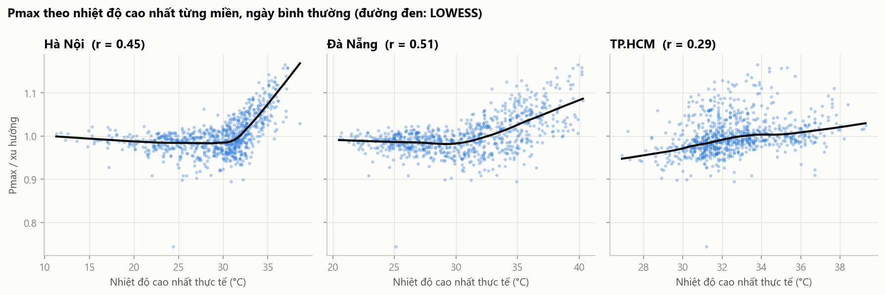
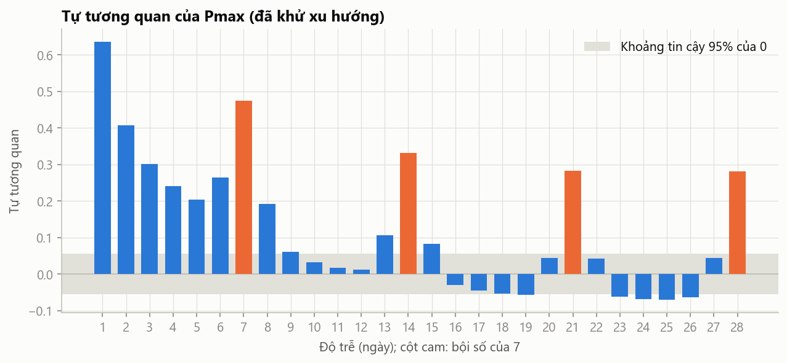
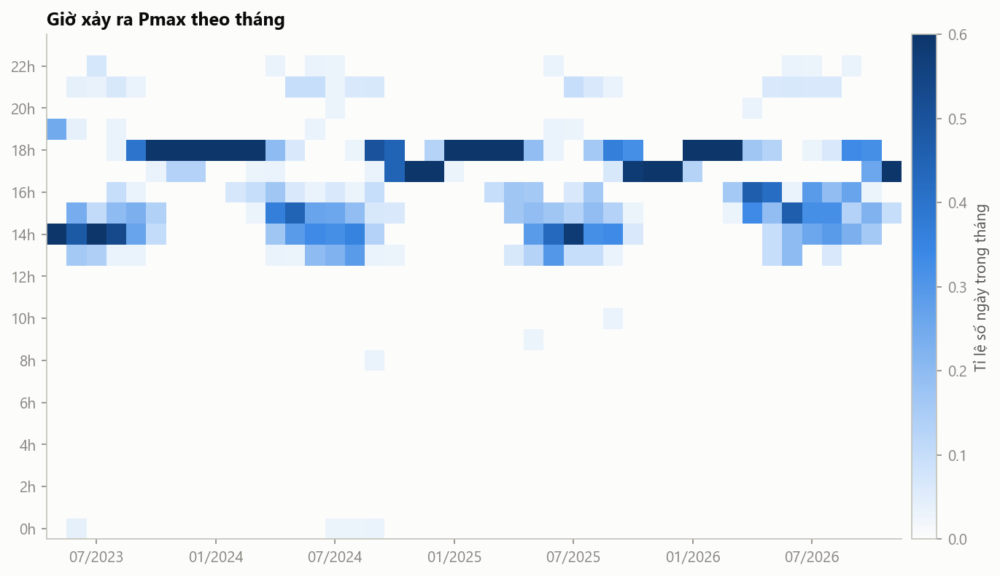

# Báo cáo phân tích khám phá dữ liệu (EDA)

- **Dữ liệu:** `evn_daily.csv`, `weather.csv`, `calendar.csv`, giai đoạn 28/05/2023 → 10/11/2026 (1 263 ngày lịch, 1 254 ngày có số liệu EVN).
- **Mã nguồn:** [`notebooks/01_eda.ipynb`](../notebooks/01_eda.ipynb). Chạy lại: `jupyter nbconvert --to notebook --execute --inplace notebooks/01_eda.ipynb`
- **Biểu đồ:** `reports/figures/`

## Tóm tắt

| # | Câu hỏi | Kết quả chính | Hệ quả cho mô hình |
|---|---|---|---|
| 1, 9 | Xu hướng | Phụ tải tăng khoảng **7,5%/năm** (Pmax 7,4%, sản lượng 7,6%) | Cần thành phần xu hướng, hoặc dự báo dạng tỉ lệ so với mức gần đây |
| 2 | Thứ trong tuần | CN thấp hơn khoảng 13% (Pmax), T7 khoảng 5%. T2–T6 gần như bằng nhau | Biến `dow` (ít nhất phân biệt T7, CN, ngày thường) |
| 3 | Ngày lễ | Giảm trung bình **22%**, dao động 5–33% | Biến `is_holiday`, độ dài kỳ nghỉ |
| 10 | Tết | Giảm tới **45–49%**, kéo dài khoảng 3 tuần, hình dạng **rất giống nhau** qua 3 năm | Biến `tet_offset` dạng từng ngày, có thể xử lý riêng |
| 4 | Nhiệt độ | Quan hệ **phi tuyến dạng "gậy khúc côn cầu"**: phẳng dưới 30°C, tăng mạnh trên 30°C (Hà Nội) | Biến kiểu `max(0, Tmax − 30)`, giữ riêng từng miền |
| 4 | Trọng số miền | Hồi quy cho thấy TP.HCM và Đà Nẵng có trọng số lớn hơn giả định | Không dùng cố định 0,45/0,10/0,45; để mô hình tự học |
| 5 | Tự tương quan | **Lag 7 (0,47) mạnh hơn lag 2 (0,41)**; lag 1 không dùng được | Biến lag 2, 7, 14, 21, 28 |
| 6 | Giờ Pmax | Mùa đông: Pmax buổi tối (17–18h). Mùa hè: Pmax buổi chiều (13–16h) | Pmax mùa hè phụ thuộc nhiệt độ ban ngày |
| 7 | Bất thường | 26/834 ngày làm việc lệch > 8%: nắng nóng cực đoan, mưa lớn, ngày kề lễ, lỗi số liệu | Cần làm sạch các ngày bị cờ QC |
| 8 | Baseline | MAPE Pmax tốt nhất **5,63%** (TB 4 tuần cùng thứ); ngày lễ/Tết sai **24%** | Mô hình phải thấp hơn khoảng 5,6% (Pmax) và 6,4% (sản lượng) |

**Phát hiện mới về chất lượng dữ liệu:** 7 cặp ngày liền nhau có số liệu **giống hệt nhau đến từng chữ số** (EVN đăng nhầm). Đã thêm cờ `qc_same_as_adjacent` (xem `Data.md` mục 3.3).

---

## Phương pháp chung

- **Ngày bình thường:** thứ Hai–thứ Sáu, không nghỉ, cách Tết hơn 10 ngày (834 ngày). Dùng làm mốc so sánh.
- **Tỉ lệ so với mức nền** (`*_ratio`): giá trị chia cho trung vị trượt 29 ngày của các ngày bình thường. Tỉ lệ này loại bỏ xu hướng và mùa vụ, dùng để đo hiệu ứng thứ, lễ, Tết và tìm ngày bất thường.
- **Khử xu hướng** (`*_detr`): giá trị chia cho xu hướng log-tuyến tính theo thời gian. Chỉ loại bỏ tăng trưởng, giữ nguyên mùa vụ và ảnh hưởng của thời tiết. Dùng cho phân tích nhiệt độ và tự tương quan.

---

## Câu 1 và 9: Xu hướng và tăng trưởng

| Năm so với năm trước | Pmax TB tháng | Sản lượng TB tháng | Số tháng so sánh |
|---|---|---|---|
| 2024 / 2023 | +8,2% | +8,8% | 8 (tháng 5–12) |
| 2025 / 2024 | +5,8% | +4,3% | 12 |
| 2026 / 2025 | +8,5% | +10,4% | 12 (gồm 01–11/2026) |

Xu hướng log-tuyến tính trên ngày bình thường: **Pmax +7,4%/năm, sản lượng +7,6%/năm**.

**Nhận xét**
- Tăng trưởng **không đều**: năm 2025 chậm (+4–6%), năm 2026 nhanh (+8–10%). Mùa hè 2026 đạt kỷ lục: Pmax 57 537 MW ngày 24/06/2026.
- **Mùa vụ trong năm:** thấp nhất vào tháng 1–2 (Tết), cao vào tháng 5–8 (nóng). Tháng 9 thường giảm (mưa bão, lễ 2/9).

**Hệ quả cho mô hình:** mức phụ tải không dừng (non-stationary). Mô hình cây quyết định (LightGBM) **không ngoại suy được** ra ngoài khoảng giá trị đã thấy. Cần: (a) dự báo **tỉ lệ** so với mức gần đây (ví dụ trung bình 4 tuần cùng thứ), hoặc (b) thêm thành phần xu hướng. Phương án (a) được ưu tiên.

---

## Câu 2: Hiệu ứng thứ trong tuần

| Thứ | Pmax / mức nền | Sản lượng / mức nền |
|---|---|---|
| T2 | 1,000 | **0,978** |
| T3–T6 | 0,995 – 1,003 | 1,003 – 1,009 |
| T7 | **0,953** | **0,974** |
| CN | **0,865** | **0,880** |

**Nhận xét**
- Thứ Bảy giảm ít (công nghiệp vẫn chạy), Chủ nhật giảm rõ.
- **Thứ Hai:** Pmax bình thường nhưng sản lượng thấp hơn 2%, vì đầu ngày thứ Hai còn chịu ảnh hưởng đêm Chủ nhật.
- Ngày làm việc ngay **sau** kỳ nghỉ thấp hơn khoảng 2% (0,977). Phần lớn các ngày này là thứ Hai, nên hiệu ứng trùng với hiệu ứng thứ Hai. Ngày ngay **trước** kỳ nghỉ không khác biệt (1,003).

**Hệ quả:** biến `dow` dạng phân loại. `is_day_off` (coi T7 là ngày nghỉ) không phù hợp, như đã ghi ở `Data.md` mục 6.1.

---

## Câu 3 và 10: Ngày lễ và Tết

### Ngày lễ ngoài Tết

Trung bình **0,78** (Pmax) và **0,78** (sản lượng) so với mức nền, trên 25 ngày lễ. Mức giảm phụ thuộc vào vị trí trong kỳ nghỉ:
- Ngày chính của kỳ nghỉ dài (30/4–1/5, 2/9): giảm mạnh nhất, 0,67–0,79.
- Ngày nghỉ hoán đổi hoặc nghỉ bù ở đầu, cuối kỳ (29/04/2024, 27/04/2026, 02/05/2025): giảm ít, 0,85–0,95.

### Tết Nguyên đán

| Tết | Mùng 1 | Tỉ lệ thấp nhất | Ngày làm việc cuối còn ≥ 0,95 | Ngày làm việc đầu tiên ≥ 0,95 sau Tết |
|---|---|---|---|---|
| 2024 | 10/02/2024 | 0,542 (Mùng 3) | Mùng 1 − 8 ngày | Mùng 1 + 10 ngày |
| 2025 | 29/01/2025 | 0,514 (Mùng 1) | Mùng 1 − 7 ngày | Mùng 1 + 13 ngày |
| 2026 | 17/02/2026 | 0,559 (Mùng 1) | Mùng 1 − 7 ngày | Mùng 1 + 9 ngày |

**Nhận xét**
- Ba lần Tết có **hình dạng gần như trùng nhau**: giảm dần từ khoảng 7 ngày trước Tết, đáy ở Mùng 1–3 (chỉ còn khoảng 51–56%), hồi phục chậm trong 9–13 ngày sau.
- Hồi phục sau Tết **chậm hơn** giảm trước Tết (bất đối xứng).

**Hệ quả:**
- Tết là thời kỳ **khó dự báo nhất** với baseline (sai số khoảng 25%, xem câu 8), nhưng lại **dễ dự báo** nếu có biến `tet_offset`, vì hình dạng lặp lại rất đều.
- Mô hình cần `tet_offset` dạng từng ngày trong khoảng −10 → +15. Có thể thêm mô hình riêng hoặc hệ số hiệu chỉnh cho giai đoạn Tết.
- Chỉ có 3 lần Tết, nên kết luận về Tết có **độ tin cậy hạn chế**.

---

## Câu 4: Nhiệt độ và phụ tải

Tương quan Pearson giữa Pmax (đã khử xu hướng) và thời tiết **thực tế**, trên ngày bình thường:

| Biến | Hà Nội | Đà Nẵng | TP.HCM | Toàn quốc (TB có trọng số) |
|---|---|---|---|---|
| Tmax | 0,45 | 0,51 | 0,29 | **0,55** |
| Tmean | 0,42 | 0,47 | 0,40 | 0,50 |
| Nhiệt độ cảm nhận max | 0,44 | 0,46 | 0,36 | 0,49 |
| Bức xạ | 0,44 | 0,43 | 0,29 | 0,54 |
| Độ ẩm | −0,06 | −0,49 | −0,09 | −0,17 |

Pmax / xu hướng theo khoảng Tmax Hà Nội:

| Tmax Hà Nội | ≤ 20°C | 20–25 | 25–30 | 30–35 | > 35°C |
|---|---|---|---|---|---|
| Pmax / xu hướng | 0,99 | 0,98 | 0,98 | 1,01 | **1,09** |
| Số ngày | 43 | 125 | 219 | 389 | 49 |

**Nhận xét**
- **Phi tuyến rõ rệt** ở Hà Nội: phụ tải gần như không đổi khi Tmax dưới 30°C, rồi tăng mạnh khi trên 30°C, và tăng khoảng **9%** khi trên 35°C. Không thấy phụ tải tăng khi trời lạnh (không có hiệu ứng sưởi).
- TP.HCM có quan hệ gần tuyến tính và yếu hơn, vì khí hậu nóng quanh năm, biên độ nhiệt hẹp (27–39°C).
- **Trung bình có trọng số toàn quốc tương quan tốt hơn từng miền riêng lẻ** (0,55), vì phụ tải là tổng của cả 3 miền.
- Về giả định trọng số: hồi quy Pmax theo Tmax 3 miền cho trọng số ngầm định **Hà Nội 0,16, Đà Nẵng 0,30, TP.HCM 0,54**, khác xa giả định 0,45/0,10/0,45. Tuy vậy, nhiệt độ 3 miền **tương quan mạnh với nhau** (đều theo mùa), nên các hệ số này không ổn định. Đây chỉ là dấu hiệu, chưa phải ước lượng tin cậy.
- Độ ẩm ở Đà Nẵng tương quan âm (−0,49), vì mùa mưa miền Trung (tháng 9–12) trùng với giai đoạn phụ tải thấp. Đây là **tương quan do mùa**, không phải quan hệ nhân quả.

**Hệ quả:**
- Đưa nhiệt độ vào mô hình dạng **ngưỡng**: `max(0, Tmax − 30)` cho từng miền, hoặc dùng mô hình cây để tự học dạng phi tuyến.
- Giữ riêng nhiệt độ từng miền, **không cố định trọng số 0,45/0,10/0,45**.
- Bức xạ tương quan cao nhưng trùng thông tin với nhiệt độ. Cần kiểm tra khi chọn biến.

---

## Câu 5: Tự tương quan

| Độ trễ | 1 | 2 | 3 | 6 | **7** | 14 | 21 | 28 |
|---|---|---|---|---|---|---|---|---|
| ACF (Pmax / xu hướng) | 0,64 | 0,41 | 0,30 | 0,27 | **0,47** | 0,33 | 0,28 | 0,28 |

**Nhận xét**
- Tự tương quan giảm nhanh sau 1–3 ngày, nhưng **nhảy lên ở các bội số của 7** (chu kỳ tuần).
- **Lag 7 (0,47) mạnh hơn lag 2 (0,41).** Vì lag 1 không dùng được trong thực tế (khoảng cách dự báo là 2 ngày), thông tin "cùng thứ tuần trước" quý hơn "2 ngày trước".

**Hệ quả:** biến lag 2, 7, 14, 21, 28 và trung bình trượt của các lag cùng thứ. **Không dùng lag 1** (rò rỉ thông tin, xem `Data.md` mục 2.5).

---

## Câu 6: Giờ xảy ra Pmax

| Tháng | 1 | 2 | 3 | 4 | 5 | 6 | 7 | 8 | 9 | 10 | 11 | 12 |
|---|---|---|---|---|---|---|---|---|---|---|---|---|
| % ngày Pmax từ 17h | 100 | 98 | 86 | 36 | 19 | 11 | 12 | 15 | 47 | 79 | 99 | 100 |
| % ngày Pmax 12h–17h | 0 | 2 | 14 | 64 | 80 | 88 | 88 | 85 | 51 | 21 | 1 | 0 |

**Nhận xét**
- **Hai chế độ theo mùa:** mùa đông (tháng 11–3) Pmax xảy ra **buổi tối** (17–18h, khi chiếu sáng và sinh hoạt cộng thêm). Mùa hè (tháng 4–8) Pmax xảy ra **buổi chiều** (13–16h, do điều hòa).
- Tháng 4 và tháng 9 là **giai đoạn chuyển tiếp**.
- **Không thấy** giờ Pmax dịch chuyển giữa thời kỳ trước và sau 04/06/2024: tỉ lệ ngày Pmax từ 17h là 56,5% so với 55,1%.
- Từ 04/06/2024, Pmax tính theo hai cách (thương phẩm và đầu cực) lệch giờ nhau ở **19%** số ngày. Pmax đầu cực cao hơn trung bình **309 MW**.
- Vài ngày Pmax ghi nhận lúc 0h–10h (ví dụ "lúc 0h30" ngày 04/06/2023). Đây là bất thường của số liệu gốc, chưa rõ nguyên nhân.

**Hệ quả:** Pmax mùa hè do nhiệt độ ban ngày quyết định, còn Pmax mùa đông do nhu cầu buổi tối. Có thể cần **biến tương tác** giữa nhiệt độ và mùa, hoặc để mô hình cây tự học.

---

## Câu 7: Ngày bất thường

Tiêu chí: thứ Hai–Sáu, không nghỉ, cách Tết hơn 10 ngày, sản lượng lệch hơn 8% so với mức nền. Kết quả: **26/834 ngày** (3,1%). Chi tiết trong notebook.

| Nhóm | Ngày | Nhận xét |
|---|---|---|
| **Nắng nóng, phụ tải cao bất thường** | 29/05, 14/06/2024; 09/05/2025; 26–27/05, 23–25/06, 12–13/08, 29/09–02/10/2026 | Tmax Hà Nội 33–38°C, Đà Nẵng tới 40°C. Mức nền trượt 29 ngày chưa theo kịp đợt nóng |
| **Mưa lớn, phụ tải thấp** | 10/06/2024; 28/10/2024; 21–22/07, 18/08, 29/09/2025 | Lượng mưa trong ngày tại Hà Nội hoặc TP.HCM 35–74 mm (theo Open-Meteo). Có thể trùng các cơn bão. Cần đối chiếu với thông tin khí tượng |
| **Ngày kề lễ** | 03/09/2025; 02/01/2026 | Ngày làm việc kẹp giữa kỳ nghỉ và cuối tuần |
| **Lỗi số liệu** | 31/12/2025 | Trùng y hệt số liệu 01/01/2026 (cờ `qc_same_as_adjacent`) |
| Chưa rõ | 26/06/2023, 19/07/2023, 26/05/2025 | Tháng 6/2023 có thể liên quan đến tình trạng thiếu điện ở miền Bắc. Cần kiểm chứng |

**Ngày bị cờ chất lượng** (cần xử lý ở bước làm sạch):
- `|qc_energy_diff| > 2`: 13 ngày (04/07/2023; 24/05–02/06/2024; 20/09/2025; 10/10/2025).
- `qc_same_as_adjacent = 1`: 14 ngày (7 cặp: 05–06/06/2023, 23–24/08/2024, 28/02–01/03/2025, 04–05/07/2025, 31/12/2025–01/01/2026, 30–31/01/2026, 15–16/03/2026).

**Hệ quả:**
- Mưa lớn và bão làm phụ tải giảm 8–13%. Có thể thêm biến lượng mưa, nhưng dự báo mưa thường kém chính xác.
- Các ngày bị cờ QC nên **loại khỏi tập huấn luyện** hoặc thay bằng NaN. Biến mục tiêu `pmax_mw` của ngày 20/09/2025 vẫn hợp lý, chỉ cột `e_hydro` sai.

---

## Câu 8: Baseline

Dự báo cho ngày t **chỉ dùng thông tin có trước lúc dự báo** (lag ≥ 2). MAPE (%):

| Biến | Baseline | 12 tháng gần nhất | 12 tháng: ngày thường | 12 tháng: lễ/Tết | Toàn bộ |
|---|---|---|---|---|---|
| Pmax | lag1 (không khả thi, chỉ tham khảo) | 5,15 | 5,01 | 6,73 | 5,35 |
| Pmax | lag2 | 7,20 | 6,64 | 13,65 | 7,48 |
| Pmax | lag7 | 6,01 | 4,37 | 25,01 | 5,85 |
| Pmax | **TB lag 7, 14, 21, 28** | **5,63** | **4,01** | 24,37 | **5,54** |
| Sản lượng | lag1 (không khả thi) | 4,60 | 4,39 | 7,04 | 4,87 |
| Sản lượng | **lag2** | **6,44** | 5,76 | 14,25 | 6,79 |
| Sản lượng | lag7 | 6,86 | 5,03 | 28,08 | 6,54 |
| Sản lượng | TB lag 7, 14, 21, 28 | 6,59 | **4,85** | 26,78 | **6,35** |

"12 tháng gần nhất" = 11/11/2025 → 10/11/2026. "Lễ/Tết" = ngày lễ hoặc cách Tết ≤ 10 ngày.

**Nhận xét**
- Baseline tốt nhất cho ngày thường là **trung bình 4 tuần cùng thứ**: 4,0% (Pmax), 4,9% (sản lượng).
- Mọi baseline cùng thứ đều sai rất nặng vào **lễ/Tết (24–28%)**. Đây là nơi mô hình có nhiều dư địa cải thiện nhất.
- Khoảng cách 2 ngày làm mất khoảng 2 điểm phần trăm MAPE (lag1 so với lag2), cho thấy giả định về thời điểm dự báo rất quan trọng.

**Mốc mô hình cần vượt (12 tháng gần nhất): Pmax 5,63%, sản lượng 6,44%.**

---

## Giới hạn của phân tích

- Chỉ có 3 lần Tết và khoảng 3,5 năm dữ liệu. Kết luận về Tết và mùa vụ năm có độ tin cậy hạn chế.
- Phân tích nhiệt độ dùng thời tiết **thực tế** (`obs_`). Khi dự báo thật chỉ có bản dự báo (`fc_`), sai số khoảng 1°C, nên ảnh hưởng thực tế của nhiệt độ lên độ chính xác sẽ yếu hơn.
- Mức nền trượt 29 ngày phản ứng chậm với các đợt nắng nóng, nên một số ngày "bất thường" thực ra là đầu đợt nóng.
- Các ngày bị cờ QC chưa được loại khỏi phân tích này. Ảnh hưởng nhỏ (27/1 254 ngày), riêng ngày 31/12/2025 làm lệch kết quả câu 7.
- Nhận định về bão và tình trạng thiếu điện năm 2023 chưa được kiểm chứng bằng nguồn độc lập.

## Đề xuất cho Giai đoạn 4

1. **Làm sạch:** loại hoặc đặt NaN cho các ngày bị cờ `qc_same_as_adjacent` và `|qc_energy_diff| > 2` (chỉ ảnh hưởng `e_*`).
2. **Biến mục tiêu:** dự báo **tỉ lệ** `y(t) / TB(y(t−7), y(t−14), y(t−21), y(t−28))` thay vì giá trị tuyệt đối, để xử lý xu hướng tăng.
3. **Biến đầu vào:**
   - Lag 2, 7, 14, 21, 28.
   - `dow`, `is_holiday`, `off_block_len`, `tet_offset` (khoảng −10 → +15), `is_post_day_off`.
   - Nhiệt độ **dự báo** (`fc_`) từng miền, dạng ngưỡng `max(0, Tmax − 30)`, tương tác với mùa.
4. **Đánh giá:** walk-forward trên 12 tháng gần nhất. Báo cáo riêng ngày thường và lễ/Tết. So với baseline TB 4 tuần cùng thứ.
