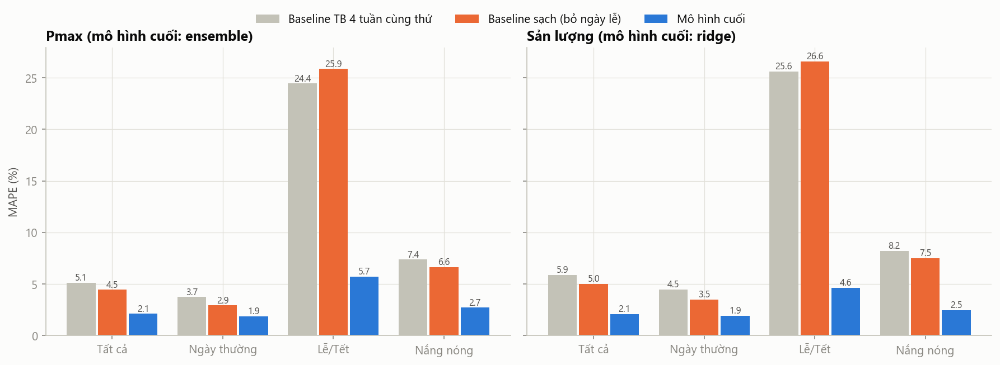
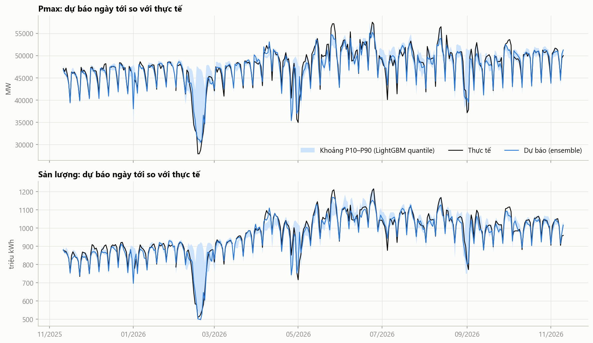
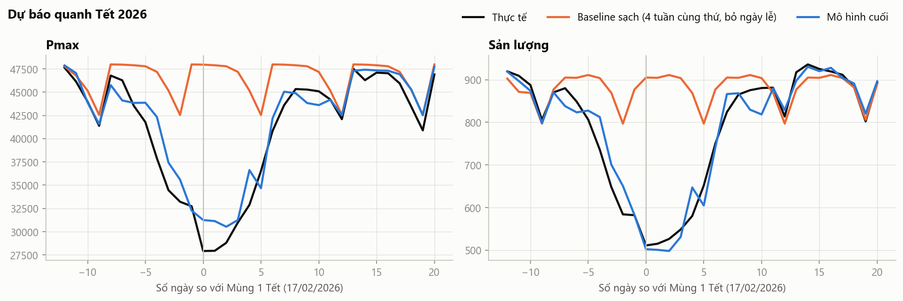
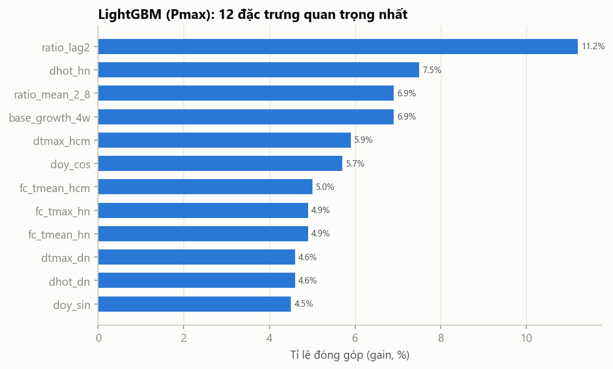

# Báo cáo mô hình dự báo (Giai đoạn 4)

- **Mã nguồn:** [`features.py`](../features.py) (đặc trưng), [`train.py`](../train.py) (huấn luyện, backtest, kiểm định), [`notebooks/02_modeling.ipynb`](../notebooks/02_modeling.ipynb) (phân tích kết quả).
- **Kết quả:** `data/backtest.csv` (dự báo từng ngày), `data/backtest_metrics.csv`, `data/backtest_dm.csv`, `models/params.json`.
- **Chạy lại:** `python train.py`, sau đó `jupyter nbconvert --to notebook --execute --inplace notebooks/02_modeling.ipynb`

## Tóm tắt

Trên tập test (11/11/2025 → 10/11/2026, 329 ngày dùng để so sánh):

| Biến | Mô hình cuối | MAPE | MAE | Baseline TB 4 tuần cùng thứ | Giảm sai số |
|---|---|---|---|---|---|
| **Pmax** | Ensemble (Ridge + LightGBM) | **2,12%** | 993 MW | 5,12% | −59% |
| **Sản lượng** | Ridge | **2,10%** | 20 triệu kWh | 5,88% | −64% |

- Cả hai mô hình **tốt hơn baseline có ý nghĩa thống kê** (Diebold–Mariano, p < 0,001).
- Cải thiện lớn nhất ở **lễ/Tết**: MAPE giảm từ khoảng 25% xuống khoảng 5%.
- Hạn chế chính: **khoảng dự báo P10–P90 quá hẹp** (độ phủ 64–66% thay vì 80%), và **ngày nghỉ bù** bị dự báo thấp quá mức.

---

## Đọc kết quả thế nào (giải thích dễ hiểu)

### MAPE 2,1% nghĩa là gì?

**MAPE** (Mean Absolute Percentage Error) là **sai số phần trăm trung bình**: trung bình mỗi ngày, dự báo lệch khỏi thực tế bao nhiêu phần trăm.

> **MAPE 2,1% = sai số trung bình khoảng 2%, tức là độ chính xác khoảng 98%.**
>
> MAPE càng **nhỏ** càng tốt. Không nên đọc "2%" là "độ chính xác 2%".

### Quy ra con số cụ thể

| | Pmax | Sản lượng |
|---|---|---|
| Giá trị thực tế trung bình trên tập test | 47 889 MW | 973 triệu kWh |
| Sai số trung bình mỗi ngày (MAE) | **~1 000 MW** | **~20 triệu kWh** |
| Sai số của một ngày "điển hình" (trung vị) | ~755 MW (1,6%) | ~16 triệu kWh (1,7%) |
| 9/10 ngày có sai số không quá | 2 283 MW (4,5%) | 41 triệu kWh (4,1%) |

**Ví dụ:** một ngày có Pmax thực tế khoảng 48 000 MW thì dự báo thường nằm trong khoảng **47 000 – 49 000 MW**.

### Bao nhiêu ngày dự báo "sát"?

Tỉ lệ số ngày (trong 329 ngày test) có sai số nhỏ hơn mức cho trước:

| Sai số nhỏ hơn | Pmax: mô hình | Pmax: baseline | Sản lượng: mô hình | Sản lượng: baseline |
|---|---|---|---|---|
| 1% | 35,0% | 22,8% | 35,0% | 19,5% |
| 2% | **60,2%** | 42,6% | **59,0%** | 36,2% |
| 3% | **76,6%** | 59,0% | **77,2%** | 46,5% |
| 5% | **93,9%** | 71,7% | **94,5%** | 63,8% |

Đọc bảng: với Pmax, **gần 94% số ngày** mô hình dự báo lệch dưới 5%. Baseline chỉ đạt mức này ở khoảng 72% số ngày. Những ngày sai trên 5% (khoảng 6%) chủ yếu rơi vào **ngày nghỉ bù, kỳ nghỉ lễ và quanh Tết** (mục 10).

### So với các cách dự báo đơn giản

| Cách dự báo Pmax | Sai số (MAPE) | Độ chính xác tương đương |
|---|---|---|
| Lấy số liệu 2 ngày trước (số liệu mới nhất có được) | 7,1% | ~93% |
| Trung bình 4 ngày cùng thứ của 4 tuần trước (baseline) | 5,1% | ~95% |
| **Mô hình của dự án** | **2,1%** | **~98%** |

Mô hình giảm sai số khoảng **2,4 lần** so với baseline. Nói cách khác, cứ 100 MW sai số của baseline thì mô hình chỉ còn khoảng 41 MW.

### Kết quả này tốt đến mức nào?

- **So với baseline:** tốt hơn rõ rệt, và đã kiểm định thống kê (mục 7): không phải do may mắn.
- **So với thực tế ngành:** dự báo phụ tải ngày tới cấp quốc gia thường được nhắc đến với MAPE khoảng 1,5–3%. Đây là nhận định tham khảo chung, **chưa dẫn nguồn cụ thể**. Nếu dùng trong báo cáo chính thức, cần bổ sung trích dẫn (bài báo khoa học hoặc báo cáo của đơn vị điều độ).
- **Giới hạn:** mô hình chỉ có thông tin đến 2 ngày trước và nhiệt độ dự báo. Không biết các sự kiện bất ngờ (bão, sự cố, cắt điện), nên những ngày như vậy vẫn có thể sai nhiều.

---

## 1. Bài toán

- **Dự báo ngày tới:** dự báo cho ngày D+1 được lập trong ngày D, sau khi EVN đăng số liệu ngày D−1 (khoảng 11h). Vì vậy mọi đặc trưng lấy từ số liệu EVN đều có **độ trễ ≥ 2 ngày** (`MIN_LAG = 2`).
- **Biến mục tiêu:** `pmax_mw` (MW) và `energy_mkwh` (triệu kWh), dùng chung một quy trình.
- **Thông tin được dùng cho ngày cần dự báo:** lịch (biết trước), và nhiệt độ **dự báo** phát hành trước 1 ngày (`fc_`). Không dùng thời tiết thực tế của ngày cần dự báo.

## 2. Dữ liệu và làm sạch

| Bước | Chi tiết |
|---|---|
| Lịch đầy đủ | 28/05/2023 → 10/11/2026. 9 ngày EVN không đăng bài để trống |
| Loại số liệu nghi sai | 14 ngày có cờ `qc_same_as_adjacent = 1` → đặt NaN cho biến mục tiêu. Không dùng làm nhãn, không dùng làm lag, không tính điểm |
| Thời tiết dự báo thiếu | 21 ngày (30/12/2023 → 19/01/2024) thiếu `fc_tmax`/`fc_tmean`. Điền bằng số liệu thực tế. Chỉ ảnh hưởng tập huấn luyện |
| Biến thời tiết dùng | Chỉ nhiệt độ (`fc_tmax`, `fc_tmean`), theo quyết định (a): các biến dự báo khác chỉ có từ 20/01/2024 |
| Bắt đầu huấn luyện | 01/07/2023 |

## 3. Cách mô hình hóa: dự báo tỉ lệ so với baseline sạch

Phụ tải tăng khoảng 7,5%/năm (EDA câu 1), mà mô hình cây không ngoại suy được ra ngoài khoảng giá trị đã thấy. Vì vậy mô hình **không dự báo trực tiếp giá trị**, mà dự báo tỉ lệ so với một baseline:

```
base(t)  = trung bình của 4 ngày cùng thứ gần nhất trước t (t−7, t−14, …, tối đa t−56)
           KHÔNG phải ngày lễ hay cận Tết (±10 ngày), và có số liệu
ratio(t) = y(t) / base(t)
dự báo   = ratio dự báo × base(t)
```

"Baseline sạch" khác baseline TB 4 tuần thông thường ở chỗ **bỏ qua ngày lễ trong các tuần tham chiếu**. Nếu tuần trước có lễ, baseline thông thường bị kéo thấp xuống. Bản thân baseline sạch cũng được báo cáo như một baseline riêng, để tách bạch phần cải thiện đến từ mẫu số và phần đến từ mô hình.

## 4. Đặc trưng (`features.py`)

| Nhóm | Đặc trưng | Ý nghĩa | Căn cứ từ EDA |
|---|---|---|---|
| Lịch của ngày cần dự báo | `dow` | Thứ trong tuần (0 = T2 … 6 = CN) | Câu 2 |
| | `is_holiday`, `off_block_len` | Ngày lễ; độ dài kỳ nghỉ chứa ngày đó | Câu 3 |
| | `is_pre_day_off`, `is_post_day_off`, `is_makeup_workday` | Ngày làm việc trước/sau kỳ nghỉ; thứ Bảy đi làm bù | Câu 2, 3 |
| | `tet_offset` | Số ngày so với Mùng 1 Tết, trong khoảng −10 → +15. Ngoài khoảng gán 99 | Câu 10 |
| | `doy_sin`, `doy_cos` | Vị trí trong năm (mùa vụ) | Câu 1 |
| Độ lệch gần đây (lag ≥ 2) | `ratio_lag2` | Tỉ lệ y/base của ngày t−2 (chỉ ngày thường) | Câu 5 |
| | `ratio_mean_2_8` | Trung bình tỉ lệ y/base từ t−8 đến t−2 (chỉ ngày thường) | Câu 5 |
| | `base_growth_4w` | Tăng trưởng của baseline so với 4 tuần trước | Câu 1 |
| Nhiệt độ dự báo, mỗi miền `hn`, `dn`, `hcm` | `fc_tmax_*`, `fc_tmean_*` | Nhiệt độ cao nhất và trung bình dự báo | Câu 4 |
| | `hot_*` | `max(0, Tmax dự báo − 30)`: phần nhiệt độ vượt ngưỡng 30°C | Câu 4 (phi tuyến) |
| | `dtmax_*` | Tmax dự báo trừ Tmax thực tế trung bình của các ngày tham chiếu của baseline | Mô hình dự báo tỉ lệ, nên cần chênh lệch nhiệt độ |
| | `dhot_*` | Tương tự, cho phần vượt 30°C | Câu 4 |

Mô hình Ridge dùng bản mã hóa riêng (`ridge_design`): `dow` mã hóa one-hot, `tet_offset` gộp thành 7 nhóm (−10…−8, −7…−4, −3…−1, 0…3, 4…6, 7…10, 11…15), thêm tương tác ngày lễ × thứ Bảy/Chủ nhật.

**Kiểm tra rò rỉ thông tin:** mọi giá trị EVN dùng trong đặc trưng của ngày t đều thuộc ngày ≤ t−2. Thời tiết của ngày t là bản dự báo. Thời tiết thực tế chỉ dùng cho các ngày tham chiếu (≤ t−7).

## 5. Mô hình

| Mô hình | Mô tả |
|---|---|
| `lag2` | Giá trị ngày t−2 (số liệu mới nhất có được) |
| `lag7` | Giá trị ngày t−7 (cùng thứ tuần trước) |
| `mean_lag7_28` | Trung bình t−7, t−14, t−21, t−28 (baseline chính của EDA) |
| `clean_base` | Baseline sạch (mục 3) |
| `ridge` | Hồi quy Ridge trên tỉ lệ, chuẩn hóa biến, điền giá trị thiếu bằng trung vị |
| `lightgbm` | LightGBM trên tỉ lệ, learning rate 0,03, subsample 0,9 |
| `ensemble` | Trung bình dự báo của Ridge và LightGBM |
| LightGBM quantile | Hai mô hình phân vị 0,1 và 0,9 → khoảng dự báo P10–P90 |

## 6. Quy trình đánh giá

```
|—— huấn luyện ——————————|—— kiểm định ——————|——— test ———————————|
 01/07/2023                11/11/2024           11/11/2025        10/11/2026
                           chọn tham số và      chỉ dùng một lần,
                           chọn mô hình cuối    với tham số đã chọn
```

- **Walk-forward, huấn luyện lại đầu mỗi tháng** với cửa sổ mở rộng. Mô hình dùng cho các ngày từ ngày d trở đi chỉ được học nhãn đến ngày d−2. Điều này mô phỏng đúng cách vận hành thật.
- **Chọn tham số trên tập kiểm định** (MAPE): Ridge alpha ∈ {0,3; 1; 3; 10; 30; 100}; LightGBM: objective ∈ {L2, L1}, num_leaves ∈ {7, 15}, min_child_samples ∈ {10, 20}, n_estimators ∈ {300, 600}.
- **Chọn mô hình cuối trên tập kiểm định**, trong 3 ứng viên Ridge, LightGBM và Ensemble, **trước khi** xem tập test.
- **So sánh công bằng:** mọi mô hình được chấm trên **cùng một tập ngày** (có số liệu thực tế và có đủ dự báo của mọi mô hình): 329/365 ngày.
- **Chỉ số:** MAPE (chính), MAE, RMSE. Chia nhóm: tất cả; ngày thường; lễ/Tết (ngày lễ hoặc cách Tết ≤ 10 ngày); nắng nóng (10% số ngày có Tmax dự báo toàn quốc cao nhất).
- **Kiểm định Diebold–Mariano** trên sai số phần trăm tuyệt đối, có hiệu chỉnh mẫu nhỏ của Harvey và cộng sự (1997), h = 2.

### Tham số được chọn

| | Pmax | Sản lượng |
|---|---|---|
| Ridge alpha | 10 | 1 |
| LightGBM | L1, 15 lá, min_child 10, 600 cây | L2, 15 lá, min_child 10, 300 cây |
| MAPE kiểm định: baseline sạch | 4,81% | 5,83% |
| MAPE kiểm định: Ridge | 2,34% | **2,20%** |
| MAPE kiểm định: LightGBM | 2,37% | 2,65% |
| MAPE kiểm định: Ensemble | **2,25%** | 2,32% |
| **Mô hình cuối** | **Ensemble** | **Ridge** |

## 7. Kết quả trên tập test



### Pmax: MAPE (%)

| Mô hình | Tất cả | Ngày thường | Lễ/Tết | Nắng nóng | MAE (MW) |
|---|---|---|---|---|---|
| lag2 | 7,08 | 6,62 | 13,55 | 6,11 | 3 282 |
| lag7 | 5,67 | 4,16 | 26,65 | 6,45 | 2 560 |
| mean_lag7_28 | 5,12 | 3,74 | 24,44 | 7,37 | 2 270 |
| clean_base | 4,46 | 2,92 | 25,86 | 6,64 | 1 934 |
| ridge | 2,21 | 2,01 | **5,14** | 3,33 | 1 051 |
| lightgbm | 2,24 | 1,92 | 6,65 | **2,24** | 1 038 |
| **ensemble (cuối)** | **2,12** | **1,86** | 5,71 | 2,71 | **993** |

### Sản lượng: MAPE (%)

| Mô hình | Tất cả | Ngày thường | Lễ/Tết | Nắng nóng | MAE (triệu kWh) |
|---|---|---|---|---|---|
| lag2 | 6,33 | 5,75 | 14,40 | 5,97 | 59 |
| lag7 | 6,34 | 4,75 | 28,54 | 6,60 | 58 |
| mean_lag7_28 | 5,88 | 4,46 | 25,60 | 8,23 | 53 |
| clean_base | 5,03 | 3,48 | 26,58 | 7,52 | 44 |
| **ridge (cuối)** | **2,10** | 1,92 | 4,63 | 2,47 | 20 |
| lightgbm | 2,19 | 1,93 | 5,82 | 2,19 | 21 |
| ensemble | 2,00 | 1,82 | 4,47 | 2,24 | 19 |

Với sản lượng, Ensemble cho kết quả tốt hơn trên tập test (2,00%), nhưng mô hình cuối vẫn là **Ridge**, vì đó là lựa chọn của tập kiểm định. Đổi lựa chọn sau khi xem tập test là dùng thông tin của tập test để chọn mô hình, làm kết quả báo cáo bị lạc quan.

### Kiểm định Diebold–Mariano (329 ngày)

| Biến | Mô hình | So với | DM | p |
|---|---|---|---|---|
| Pmax | ensemble | mean_lag7_28 | −5,31 | < 0,0001 |
| Pmax | ensemble | clean_base | −4,12 | < 0,0001 |
| Sản lượng | ridge | mean_lag7_28 | −5,69 | < 0,0001 |
| Sản lượng | ridge | clean_base | −4,48 | < 0,0001 |

DM âm nghĩa là mô hình chính xác hơn. Mọi cặp so sánh khác (Ridge, LightGBM, Ensemble so với hai baseline) đều có p ≤ 0,0002 (`data/backtest_dm.csv`).

### Dự báo theo thời gian



MAPE theo tháng (%):

| Tháng | Pmax: mô hình | Pmax: TB 4 tuần | Sản lượng: mô hình | Sản lượng: TB 4 tuần |
|---|---|---|---|---|
| 11/2025 | 0,94 | 1,05 | 1,23 | 1,34 |
| 12/2025 | 1,10 | 1,90 | 2,34 | 3,03 |
| 01/2026 | 1,21 | 1,68 | 2,21 | 2,93 |
| **02/2026 (Tết)** | 3,61 | **17,19** | 2,87 | **18,97** |
| 03/2026 | 1,22 | 9,92 | 0,88 | 12,85 |
| 04/2026 | 3,18 | 5,32 | 2,62 | 6,69 |
| **05/2026** | **3,79** | 8,26 | 3,21 | 9,51 |
| 06/2026 | 2,13 | 3,46 | 1,95 | 3,24 |
| 07/2026 | 2,27 | 5,04 | 1,66 | 4,41 |
| 08/2026 | 2,11 | 3,27 | 2,24 | 3,12 |
| 09/2026 | 2,33 | 6,08 | 2,15 | 6,28 |
| 10/2026 | 1,43 | 2,08 | 1,90 | 3,17 |
| 11/2026 (đến 10/11) | 1,24 | 1,70 | 1,66 | 2,30 |

- Mùa đông (11–01): sai số rất thấp, khoảng 1–2%.
- **Tháng 4–5** sai nhiều nhất: kỳ nghỉ Giỗ Tổ và 30/4–1/5, cộng thêm các đợt nắng nóng đầu mùa.
- Baseline sai nặng ở tháng 3, vì 4 tuần tham chiếu rơi vào Tết. Mô hình (nhờ baseline sạch) không bị ảnh hưởng.

### Tết 2026



MAPE trong khoảng −10 → +15 ngày quanh Mùng 1 (%):

| | TB 4 tuần | Baseline sạch | Ridge | LightGBM | Ensemble |
|---|---|---|---|---|---|
| Pmax | 20,23 | 20,55 | **3,62** | 5,05 | 4,13 |
| Sản lượng | 22,84 | 22,48 | 3,80 | 4,17 | **3,24** |

Mô hình bắt được gần đúng hình dạng Tết. Sai số còn lại chủ yếu là **dự báo cao hơn thực tế ở đáy** (Mùng 1–3, khoảng +11%), và **trễ 1–2 ngày** ở pha giảm trước Tết. Mô hình chỉ học được từ 2 lần Tết (2024, 2025).

## 8. Khoảng dự báo

| Biến | Độ phủ thực tế P10–P90 | Kỳ vọng | Dưới P10 | Trên P90 | Độ rộng TB |
|---|---|---|---|---|---|
| Pmax | **66,3%** | 80% | 12,3% | 21,4% | 5,9% của y |
| Sản lượng | **64,1%** | 80% | 11,4% | 24,5% | 6,8% của y |

**Khoảng dự báo quá hẹp** (mô hình tự tin quá mức), và lệch về phía dưới: thực tế vượt P90 nhiều hơn dự kiến, nhất là trong các đợt nắng nóng năm 2026. **Chưa nên dùng khoảng này để ra quyết định.** Cần hiệu chỉnh (xem mục 11).

## 9. Mô hình dựa vào đâu



Tỉ lệ đóng góp (gain) của LightGBM theo nhóm đặc trưng, mô hình huấn luyện đến hết tập test:

| Nhóm | Pmax | Sản lượng |
|---|---|---|
| Nhiệt độ dự báo (`fc_*`, `hot_*`, `dtmax_*`, `dhot_*`) | **57,4%** | 21,5% |
| Lịch (`dow`, `is_holiday`, `off_block_len`, `tet_offset`, …) | 7,4% | **55,5%** (riêng `is_holiday` 38,6%) |
| Còn lại (độ lệch gần đây, mùa trong năm) | 35,2% | 23,0% |

- **Pmax:** đặc trưng riêng lẻ quan trọng nhất là `ratio_lag2` (độ lệch gần nhất so với baseline), nhưng **nhóm nhiệt độ chiếm hơn một nửa** tổng đóng góp, đứng đầu là `dhot_hn` (phần vượt 30°C ở Hà Nội so với các ngày tham chiếu). Điều này khớp với EDA: Pmax mùa hè do nắng nóng quyết định.
- **Sản lượng:** **lịch chiếm ưu thế**. Sản lượng cả ngày chịu ảnh hưởng của việc nghỉ làm nhiều hơn là của đỉnh nhiệt trong ngày.
- **Ridge:** các hệ số lớn nhất là `is_holiday` (−), `off_block_len` (−), `dhot_hn` (+), `is_pre_day_off` (−), các nhóm Tết `tet_0_3`, `tet_4_6` (−). Dấu của các hệ số **phù hợp với EDA**: ngày lễ và Tết làm giảm phụ tải, còn nắng nóng ở miền Bắc làm tăng.
- Với Pmax, LightGBM (mục tiêu L1) dành rất ít đóng góp cho biến lịch (7%), vì ngày lễ hiếm trong dữ liệu. Điều đó giải thích vì sao Ridge tốt hơn ở nhóm lễ/Tết, còn LightGBM tốt hơn ở nhóm nắng nóng. Ensemble kết hợp được ưu điểm của cả hai.

## 10. Phân tích ngày sai nhiều

Pmax, mô hình cuối: **6,1%** số ngày (trên 329 ngày so sánh) sai quá 5%. Sai số trung bình có dấu khoảng −0,4%, tức mô hình hơi thiên về dự báo thấp.

| Ngày | Thực tế (MW) | Dự báo | Sai số | Nguyên nhân |
|---|---|---|---|---|
| 27/04/2026 (T2) | 45 775 | 37 982 | **−17,0%** | **Nghỉ bù Giỗ Tổ:** mô hình coi như ngày lễ chính, nhưng thực tế phụ tải gần như ngày thường |
| 26/04/2026 (CN) | 40 476 | 35 407 | −12,5% | Giỗ Tổ rơi vào Chủ nhật: mô hình trừ hai lần (lễ + Chủ nhật) |
| 17–18/02/2026 | 27 919 | ~31 200 | +11–12% | Đáy Tết sâu hơn mô hình học được |
| 13/02/2026, 14/02/2026 | 37 870; 34 449 | 42 321; 37 412 | +11,8%; +8,6% | Pha giảm trước Tết đến sớm hơn dự báo |
| 02/05/2026 (T7) | 40 528 | 45 308 | +11,8% | Thứ Bảy trong kỳ nghỉ 30/4–3/5 nhưng không phải ngày lễ chính thức |
| 16/05/2026 (T7) | 51 654 | 47 029 | −9,0% | Đợt nắng nóng; mưa lớn ở Hà Nội (43 mm) theo số liệu thực tế |

## 11. Hạn chế và đề xuất cải tiến

Các vấn đề dưới đây **được phát hiện trên tập test**. Vì vậy mô hình **không được sửa** trong giai đoạn này: sửa rồi chấm lại trên chính tập test sẽ cho kết quả lạc quan sai lệch. Nếu cải tiến, cần đánh giá lại trên dữ liệu mới (sau 10/11/2026) hoặc bằng một quy trình kiểm định mới.

| # | Vấn đề | Đề xuất |
|---|---|---|
| 1 | Khoảng P10–P90 quá hẹp (độ phủ 64–66%) | Hiệu chỉnh bằng **conformal prediction** trên phần dư của tập kiểm định |
| 2 | Ngày nghỉ bù / nghỉ hoán đổi bị dự báo thấp quá mức | Thêm đặc trưng phân biệt **ngày lễ chính** với **ngày nghỉ bù/hoán đổi**, và **ngày lễ rơi vào cuối tuần** |
| 3 | Thứ Bảy, Chủ nhật nằm trong kỳ nghỉ dài nhưng không phải ngày lễ chính thức | Đặc trưng "vị trí trong kỳ nghỉ" (ngày thứ mấy trong kỳ nghỉ) |
| 4 | Tết: chỉ học từ 2 lần | Sẽ tự cải thiện khi có thêm Tết 2027. Có thể thêm hệ số hiệu chỉnh riêng cho Tết |
| 5 | Chỉ dùng nhiệt độ dự báo | Từ 2024 có thể thử thêm mưa và mây dự báo (EDA câu 7: mưa lớn làm giảm 8–13%) |
| 6 | Nhiệt độ của 21 ngày trong tập huấn luyện được điền bằng thực tế | Ảnh hưởng nhỏ, đã ghi nhận |

## 12. Kết luận

- Mô hình đạt **MAPE khoảng 2,1%** cho cả Pmax và sản lượng trên một năm test độc lập. Kết quả này **tốt hơn baseline gấp khoảng 2,5 lần**, có ý nghĩa thống kê.
- Hai thay đổi đóng góp nhiều nhất: (1) **baseline sạch** (bỏ ngày lễ khỏi tuần tham chiếu), (2) **đặc trưng lịch** cho lễ/Tết. Nhiệt độ dự báo giúp giảm sai số trong các đợt nắng nóng (Pmax: 6,6% → 2,7%).
- **Sẵn sàng cho Giai đoạn 5** (vận hành hằng ngày) với dự báo điểm. Khoảng dự báo cần hiệu chỉnh trước khi đưa vào sử dụng.

## 13. So sánh với SARIMA thuần

Mô hình đối chứng kinh điển SARIMA(2,0,1)(1,1,1)₇, chỉ dùng lịch sử Pmax, được đánh giá theo cùng quy trình trên cùng 329 ngày test:

| Pmax, MAPE | Tất cả | Ngày thường | Lễ/Tết | Nắng nóng |
|---|---|---|---|---|
| Baseline TB 4 tuần | 5,12% | 3,74% | 24,44% | 7,37% |
| SARIMA thuần | 3,71% | 2,90% | 15,04% | 4,30% |
| **Mô hình chính (Ensemble)** | **2,12%** | **1,86%** | **5,71%** | **2,71%** |

Mô hình chính tốt hơn SARIMA có ý nghĩa thống kê (Diebold–Mariano, p < 0,0001). SARIMA chỉ hơn ở độ tin cậy của khoảng dự báo (phủ 86% so với 66%). Chi tiết: [`SARIMA.md`](SARIMA.md), [`Comparison.md`](Comparison.md), [`SARIMA_Algorithm.md`](SARIMA_Algorithm.md).
