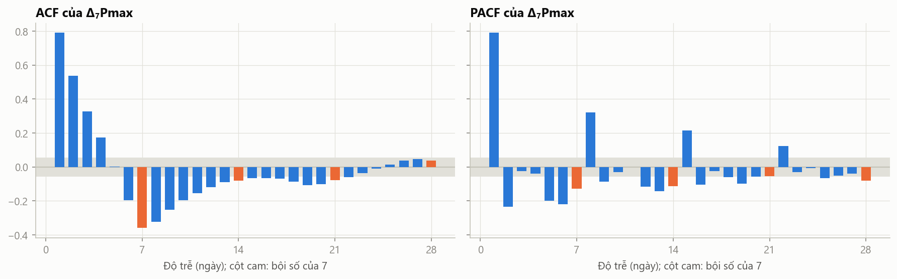
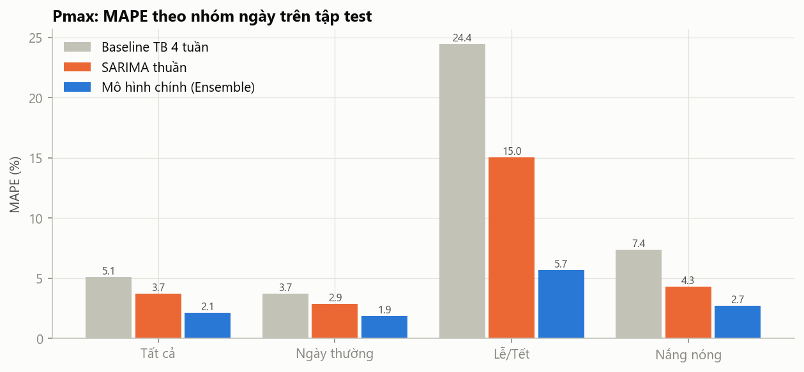
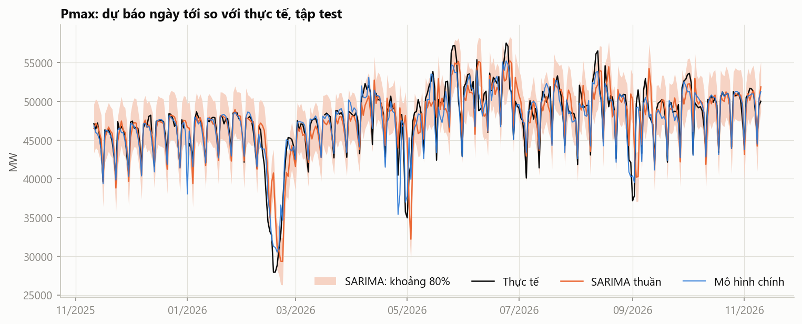
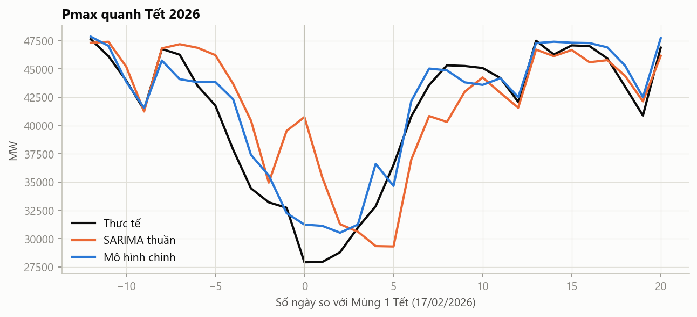
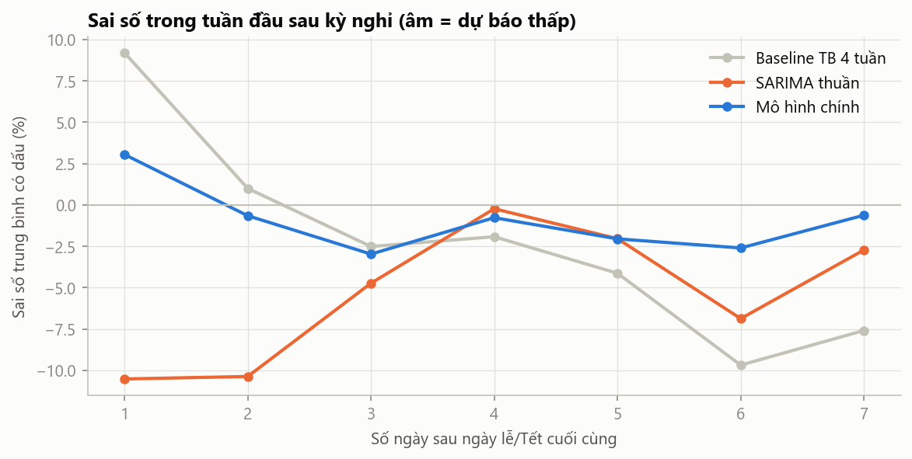

# Báo cáo mô hình SARIMA thuần cho Pmax

- **Vai trò:** mô hình **so sánh** (đối chứng kinh điển). Mô hình chính của dự án vẫn là Ensemble Ridge + LightGBM ([`Model.md`](Model.md)).
- **Mã nguồn:** [`sarima.py`](../sarima.py) (kiểm định, chọn bậc, backtest), [`notebooks/03_sarima.ipynb`](../notebooks/03_sarima.ipynb) (phân tích kết quả).
- **Kết quả:** `data/sarima_backtest.csv`, `data/sarima_metrics.csv`, `data/sarima_dm.csv`, `data/sarima_validation.csv`, `models/sarima_params.json`. Lần chạy đầu tiên được lưu riêng trong `data/sarima_run1/`.
- **Chạy lại:** `python sarima.py` (khoảng 20–25 phút), sau đó `jupyter nbconvert --to notebook --execute --inplace notebooks/03_sarima.ipynb`
- **Tài liệu liên quan:** cách thuật toán hoạt động [`SARIMA_Algorithm.md`](SARIMA_Algorithm.md); so sánh hai phương pháp [`Comparison.md`](Comparison.md).

## Tóm tắt

| | Giá trị |
|---|---|
| Mô hình | **SARIMA(2,0,1)(1,1,1)₇**, chọn trên tập kiểm định trong 72 cấu hình |
| Dữ liệu đầu vào | **Chỉ chuỗi Pmax** của các ngày trước đó (không lịch, không thời tiết) |
| MAPE trên tập test (329 ngày) | **3,71%** (độ chính xác khoảng 96,3%) |
| So với baseline TB 4 tuần (5,12%) | Tốt hơn, **có ý nghĩa thống kê** (Diebold–Mariano, p = 0,0007) |
| So với baseline sạch (4,46%) | Tốt hơn, nhưng **chưa có ý nghĩa thống kê** ở mức 5% (p = 0,066) |
| So với mô hình chính (2,12%) | **Kém hơn rõ rệt** (p < 0,0001) |
| Điểm mạnh | Ngày thường (2,90%); khoảng dự báo 80% đáng tin cậy (phủ 86% số ngày) |
| Điểm yếu | **Lễ/Tết (15,0%)** và **"dư âm" sau kỳ nghỉ** (dự báo thấp khoảng 10% trong 1–2 ngày sau lễ) |

**Kết luận một câu:** chỉ dựa vào lịch sử của chính Pmax, SARIMA đạt sai số khoảng 3,7%. Phần cải thiện từ 3,7% xuống 2,1% của mô hình chính đến từ **thông tin lịch và nhiệt độ**, những thứ SARIMA thuần không có.

---

## 1. Mục tiêu

Trả lời câu hỏi: **"Chỉ dựa vào quá khứ của chính Pmax thì dự báo được tốt đến đâu?"** SARIMA là phương pháp chuỗi thời gian kinh điển, thường dùng làm mốc so sánh trong các nghiên cứu dự báo phụ tải. Kết quả của nó cho biết mô hình chính hơn phương pháp truyền thống bao nhiêu, và phần hơn đó đến từ đâu.

## 2. Dữ liệu

| | Chi tiết |
|---|---|
| Biến | `pmax_mw` trong `data/evn_daily.csv`, **không dùng bất kỳ biến nào khác** làm đầu vào |
| Khoảng thời gian | 01/07/2023 → 10/11/2026 (1 229 ngày lịch), cùng mốc bắt đầu với mô hình chính |
| Làm sạch | 12 ngày có cờ `qc_same_as_adjacent` đặt trống (EVN đăng trùng số liệu) |
| Ngày trống | 19 ngày (4 ngày không có bài, 12 ngày bị cờ, 3 bài thiếu Pmax). Bộ lọc Kalman tự bỏ qua, không điền giá trị giả |

| Giai đoạn | Thời gian | Ngày lịch | Có giá trị |
|---|---|---|---|
| Huấn luyện ban đầu | 01/07/2023 → 10/11/2024 | 499 | 490 |
| Kiểm định (chọn bậc) | 11/11/2024 → 10/11/2025 | 365 | 361 |
| Test (chấm điểm) | 11/11/2025 → 10/11/2026 | 365 | 359 |

`calendar.csv` và `weather.csv` chỉ được dùng **sau khi dự báo xong**, để chia kết quả theo nhóm ngày khi báo cáo. Chúng không phải đầu vào của mô hình.

## 3. Phương pháp

### 3.1. Quy trình đánh giá (giống hệt mô hình chính)

- **Dự báo 2 bước:** dự báo cho ngày t chỉ dùng số liệu đến ngày t−2, vì EVN công bố chậm 1 ngày.
- **Walk-forward:** ước lượng lại tham số vào đầu mỗi tháng (cửa sổ mở rộng). Mô hình dùng cho các ngày từ d trở đi chỉ thấy dữ liệu đến d−2.
- **Chọn bậc trên tập kiểm định**, theo MAPE. Tập test chỉ dùng một lần ở cuối.
- **Chấm trên cùng 329 ngày** với các mô hình khác, kèm kiểm định Diebold–Mariano.

Dự báo 2 bước cho từng ngày được lấy từ bộ lọc Kalman của mô hình tháng đó. Cách tính này đã được kiểm chứng là **trùng khớp** với hàm dự báo chuẩn của thư viện `statsmodels` (sai khác dưới 0,01 MW).

### 3.2. Kiểm định tính dừng

| Chuỗi | Thành phần tất định | ADF | ADF p | KPSS | KPSS p |
|---|---|---|---|---|---|
| Pmax gốc | hằng số | −3,04 | 0,032 | 4,15 | 0,01 |
| Pmax gốc | **hằng số + xu hướng** | **−6,33** | **< 0,001** | **0,11** | **> 0,10** |
| Sai phân bậc 1 | hằng số | −10,59 | < 0,001 | 0,10 | > 0,10 |
| Sai phân mùa (7 ngày) | hằng số | −9,30 | < 0,001 | 0,02 | > 0,10 |

- ADF: giả thuyết H₀ là "có nghiệm đơn vị" (không dừng). KPSS: H₀ là "dừng". Hai kiểm định bổ sung cho nhau.
- Với chuỗi gốc có xu hướng: ADF bác bỏ mạnh H₀, KPSS không bác bỏ H₀. Kết luận: **chuỗi Pmax dừng quanh một xu hướng**, nên **không cần** sai phân bậc 1 (d = 0).
- Chu kỳ tuần rất mạnh (EDA câu 2), nên giữ **sai phân mùa D = 1** với chu kỳ s = 7.

### 3.3. Nhận dạng bậc (ACF/PACF)

Trên chuỗi sai phân mùa $w_t = y_t - y_{t-7}$:
- ACF giảm dần từ 0,79 và PACF có cột lớn ở độ trễ 1 (0,79) và 2 (−0,24): dấu hiệu của **AR bậc 1–2**.
- ACF có cột âm nổi bật ở độ trễ 7 (−0,36): dấu hiệu của **MA mùa bậc 1**.

### 3.4. Chọn bậc

Lưới tìm kiếm: $p, q \in \lbrace 0, 1, 2 \rbrace$, $d \in \lbrace 0, 1 \rbrace$, $P, Q \in \lbrace 0, 1 \rbrace$, $D = 1$, $s = 7$: **72 cấu hình**. Mỗi cấu hình chạy walk-forward trên cả năm kiểm định.

| Hạng | Mô hình | MAPE kiểm định |
|---|---|---|
| **1** | **SARIMA(2,0,1)(1,1,1)₇** | **4,093%** |
| 2 | SARIMA(1,0,0)(1,1,1)₇ | 4,133% |
| 3 | SARIMA(1,0,1)(1,1,1)₇ | 4,136% |
| 4 | SARIMA(2,0,0)(1,1,1)₇ | 4,137% |
| 5 | SARIMA(1,0,0)(0,1,1)₇ | 4,147% |
| 11 | Tốt nhất với d = 1: SARIMA(1,1,1)(1,1,1)₇ | 4,186% |
| 72 | SARIMA(1,1,2)(1,1,1)₇ | 12,257% |

- **10 cấu hình đứng đầu đều có d = 0**, khớp với kết luận của kiểm định tính dừng.
- Các cấu hình đứng đầu **chênh nhau rất ít** (4,09–4,15%). Mô hình đơn giản SARIMA(1,0,0)(0,1,1)₇, chỉ 2 hệ số, kém mô hình được chọn chưa tới 0,06 điểm phần trăm.
- Cấu hình tệ nhất (12,3%) lại có **AIC trung bình thấp nhất** trong lưới (11 028, so với khoảng 11 700 của các cấu hình tốt). Điều này cho thấy vì sao cần chọn bậc theo **sai số dự báo trên tập kiểm định**, không chỉ theo AIC.
- Trong 72 × 12 = 864 lần ước lượng, không lần nào thất bại; chỉ 2 lần không hội tụ hoàn toàn (đều ở các cấu hình không được chọn).

### 3.5. Minh bạch: lần chạy đầu tiên

Lần chạy đầu tiên **cố định d = 1 trước khi xem kết quả kiểm định** (lưới chỉ gồm p, q, P, Q). Kết quả của nó được lưu trong `data/sarima_run1/`.

| | Lần 1: d = 1 cố định | **Lần 2: chọn d theo kiểm định và tập kiểm định** |
|---|---|---|
| Bậc | (1,1,1)(1,1,1)₇ | **(2,0,1)(1,1,1)₇** |
| MAPE kiểm định | 4,186% | **4,093%** |
| Hệ số MA(1) của mô hình cuối | **−0,999** | 0,223 |
| Ljung–Box (độ trễ 7 / 14), p | **0,004 / 0,002** | 0,145 / 0,274 |
| MAPE test | 3,79% | 3,71% |

Ở lần 1, hệ số MA(1) ≈ −1 là **dấu hiệu kinh điển của sai phân thừa**: thành phần MA "hủy" phép sai phân không cần thiết. Phần dư cũng còn tự tương quan (Ljung–Box p < 0,01). Lần 2 sửa lại bằng cách đưa d vào lưới tìm kiếm, và **quyết định chỉ dựa trên kiểm định thống kê và tập kiểm định**, không dựa trên tập test. Kết quả test của cả hai lần đều được báo cáo ở đây.

## 4. Mô hình cuối

Ước lượng trên toàn bộ dữ liệu đến 10/11/2026, chỉ để báo cáo tham số (backtest dùng các mô hình ước lượng lại hằng tháng).

| Tham số | Ý nghĩa | Hệ số | Sai số chuẩn | z |
|---|---|---|---|---|
| $\phi_1$ (`ar.L1`) | AR bậc 1 | 0,745 | 0,218 | 3,43 |
| $\phi_2$ (`ar.L2`) | AR bậc 2 | 0,094 | 0,195 | 0,48 |
| $\theta_1$ (`ma.L1`) | MA bậc 1 | 0,223 | 0,216 | 1,03 |
| $\Phi_1$ (`ar.S.L7`) | AR mùa | 0,054 | 0,030 | 1,80 |
| $\Theta_1$ (`ma.S.L7`) | MA mùa | **−0,865** | 0,016 | **−53,8** |
| $\sigma^2$ | Phương sai nhiễu | 3 293 955 MW² (σ ≈ 1 815 MW) | | |

AIC = 21 556,7; BIC = 21 587,3. Ljung–Box trên phần dư: p = 0,145 (độ trễ 7) và 0,274 (độ trễ 14), tức **phần dư không còn tự tương quan đáng kể**.

**Nhận xét về tham số:**
- Chỉ **$\phi_1$** và **$\Theta_1$** có ý nghĩa thống kê rõ ràng. $\phi_2$, $\theta_1$ và $\Phi_1$ có |z| < 2.
- Hệ số **thay đổi mạnh giữa các lần ước lượng hằng tháng**. Ví dụ mô hình dùng cho tháng 06/2026 có $\phi_1 = 1{,}825$, $\phi_2 = -0{,}829$, $\theta_1 = -0{,}948$, trong khi mô hình cho tháng 09/2026 có $\phi_1 = 0{,}713$, $\phi_2 = 0{,}130$, $\theta_1 = 0{,}243$. Phần AR(2) và MA(1) **khó xác định ổn định** (gần như có thể thay thế nhau).
- Dù vậy, chất lượng dự báo **không nhạy** với điều này: mô hình đơn giản hơn SARIMA(1,0,0)(0,1,1)₇ cho MAPE kiểm định gần bằng (4,147% so với 4,093%).

## 5. Kết quả trên tập test

### 5.1. Tổng hợp (329 ngày, cùng tập ngày với mọi mô hình)

| Mô hình | Tất cả | Ngày thường | Lễ/Tết | Nắng nóng | MAE (MW) | RMSE (MW) |
|---|---|---|---|---|---|---|
| lag2 (số liệu 2 ngày trước) | 7,08 | 6,62 | 13,55 | 6,11 | 3 282 | 4 355 |
| lag7 (cùng thứ tuần trước) | 5,67 | 4,16 | 26,65 | 6,45 | 2 560 | 4 178 |
| TB 4 tuần cùng thứ | 5,12 | 3,74 | 24,44 | 7,37 | 2 270 | 3 745 |
| Baseline sạch | 4,46 | 2,92 | 25,86 | 6,64 | 1 934 | 3 476 |
| **SARIMA(2,0,1)(1,1,1)₇** | **3,71** | **2,90** | **15,04** | **4,30** | **1 684** | **2 647** |
| *Mô hình chính (tham khảo)* | *2,12* | *1,86* | *5,71* | *2,71* | *993* | *1 368* |

Đơn vị MAPE: %. "Lễ/Tết": ngày lễ hoặc cách Mùng 1 Tết ≤ 10 ngày. "Nắng nóng": 10% số ngày có Tmax dự báo toàn quốc cao nhất.

### 5.2. Kiểm định Diebold–Mariano

| SARIMA so với | DM | p | Kết luận |
|---|---|---|---|
| lag2 | −9,67 | < 0,0001 | SARIMA tốt hơn |
| lag7 | −4,60 | < 0,0001 | SARIMA tốt hơn |
| TB 4 tuần cùng thứ | −3,40 | 0,0007 | SARIMA tốt hơn |
| Baseline sạch | −1,85 | 0,066 | **Chưa có ý nghĩa** ở mức 5% |
| Mô hình chính | **+5,21** | < 0,0001 | **SARIMA kém hơn** |

DM âm: SARIMA chính xác hơn mô hình được so sánh; DM dương: kém hơn.

### 5.3. Phân bố sai số

| Sai số nhỏ hơn | SARIMA | Mô hình chính |
|---|---|---|
| 1% | 26,4% số ngày | 35,0% |
| 2% | 48,3% | 60,2% |
| 3% | 63,2% | 76,6% |
| 5% | 77,8% | 93,9% |

SARIMA sai trên 5% ở **22,2%** số ngày, so với 6,1% của mô hình chính.

### 5.4. Theo thời gian

MAPE theo tháng (%, trên cùng tập ngày):

| Tháng | SARIMA | Mô hình chính | TB 4 tuần |
|---|---|---|---|
| 11/2025 | 1,58 | 0,94 | 1,05 |
| 12/2025 | 1,49 | 1,10 | 1,90 |
| 01/2026 | 1,35 | 1,09 | 1,42 |
| **02/2026 (Tết)** | **10,07** | 3,89 | 19,02 |
| 03/2026 | 1,81 | 1,26 | 9,58 |
| 04/2026 | 4,05 | 3,18 | 5,32 |
| **05/2026** | **6,62** | 3,79 | 8,26 |
| 06/2026 | 4,15 | 2,13 | 3,46 |
| 07/2026 | 2,97 | 2,27 | 5,04 |
| 08/2026 | 3,98 | 2,11 | 3,27 |
| **09/2026** | **5,62** | 2,33 | 6,08 |
| 10/2026 | 1,96 | 1,43 | 2,08 |
| 11/2026 (đến 10/11) | 1,85 | 1,24 | 1,70 |

- **Mùa đông yên bình (11–01):** SARIMA chỉ sai 1,3–1,6%, gần bằng mô hình chính.
- **Các tháng có kỳ nghỉ (02, 05, 09):** sai số SARIMA tăng vọt, vì nó không biết lịch nghỉ.
- **Tháng 3:** baseline TB 4 tuần sai nặng (9,6%) do 4 tuần tham chiếu rơi vào Tết, còn SARIMA không bị ảnh hưởng (1,8%), vì nó tự thích nghi với mức gần nhất.
- **Tháng 6 và 8:** SARIMA kém cả baseline TB 4 tuần. Các đợt nắng nóng làm phụ tải biến động mạnh trong ngắn hạn, và SARIMA phản ứng chậm 2 ngày.

### 5.5. Tết 2026

MAPE trong khoảng −10 → +15 ngày quanh Mùng 1: TB 4 tuần **20,23%**, SARIMA **9,07%**, mô hình chính **4,13%**.

SARIMA bắt được hình dạng chữ V của Tết, nhưng **trễ khoảng 2 ngày**: đáy dự báo rơi vào Mùng 5–6 thay vì Mùng 1–2, và pha hồi phục cũng muộn 2 ngày. Lý do: SARIMA chỉ "thấy" phụ tải giảm sau khi số liệu giảm được công bố, tức 2 ngày sau.

### 5.6. Hiệu ứng "dư âm" sau kỳ nghỉ

Sai số trung bình **có dấu** trong tuần đầu sau ngày lễ/Tết cuối cùng (âm = dự báo thấp):

| Số ngày sau kỳ nghỉ | TB 4 tuần | **SARIMA** | Mô hình chính | Số ngày |
|---|---|---|---|---|
| 1 | +9,2% | **−10,5%** | +3,1% | 3 |
| 2 | +1,0% | **−10,4%** | −0,7% | 4 |
| 3 | −2,5% | −4,7% | −3,0% | 4 |
| 4 | −1,9% | −0,2% | −0,8% | 4 |
| 5 | −4,1% | −2,0% | −2,1% | 4 |

Trong **1–2 ngày đầu sau kỳ nghỉ, SARIMA dự báo thấp khoảng 10%**. Nguyên nhân: dự báo cho ngày t dùng số liệu ngày t−2, mà ngày t−2 lúc đó vẫn là ngày nghỉ. Mô hình "mang theo" mức phụ tải thấp của ngày nghỉ sang ngày đi làm. Ví dụ ngày 04/09/2026: SARIMA dự báo 40 303 MW, thực tế 51 481 MW, **sai −21,7%** (tính tay chi tiết trong [`SARIMA_Algorithm.md`](SARIMA_Algorithm.md)).

Số ngày mỗi nhóm rất ít (3–4 ngày), nên các con số này chỉ mang tính minh họa.

### 5.7. Những ngày sai nhiều nhất

| Ngày | Thực tế (MW) | SARIMA | Sai số | Mô hình chính | Loại ngày |
|---|---|---|---|---|---|
| 17/02/2026 | 27 919 | 40 751 | **+46,0%** | +11,9% | Mùng 1 Tết |
| 01/09/2026 | 37 167 | 50 289 | +35,3% | +8,7% | Quốc khánh |
| 30/04/2026 | 35 700 | 48 173 | +34,9% | +3,6% | Ngày Chiến thắng |
| 01/05/2026 | 34 969 | 45 001 | +28,7% | +8,0% | Quốc tế Lao động |
| 18/02/2026 | 27 943 | 35 427 | +26,8% | +11,4% | Mùng 2 Tết |
| 03/05/2026 | 41 923 | 32 187 | **−23,2%** | −4,7% | 2 ngày sau kỳ nghỉ |
| 04/09/2026 | 51 481 | 40 303 | **−21,7%** | −4,3% | 2 ngày sau kỳ nghỉ |
| 31/08/2026 | 42 102 | 50 955 | +21,0% | −4,4% | Ngày nghỉ hoán đổi |

Mọi ngày sai nhiều nhất đều thuộc một trong hai kiểu: **ngày nghỉ bị dự báo cao** (SARIMA không biết hôm đó nghỉ), hoặc **ngày đi làm sau kỳ nghỉ bị dự báo thấp** (dư âm của ngày nghỉ).

### 5.8. Khoảng dự báo

SARIMA cho khoảng dự báo từ lý thuyết của mô hình (phân phối chuẩn, mục 6 của [`SARIMA_Algorithm.md`](SARIMA_Algorithm.md)). Với khoảng 80% (P10–P90):

| | SARIMA | Mô hình chính (LightGBM quantile) |
|---|---|---|
| Độ phủ thực tế (kỳ vọng 80%) | **86,1%** | 66,3% |
| Thực tế dưới P10 / trên P90 | 7,0% / 7,0% | 12,3% / 21,4% |
| Độ rộng trung bình | 13,3% của y | 5,9% của y |

Khoảng của SARIMA **đáng tin cậy** (phủ 86%, hơi rộng hơn cần thiết, cân đối hai phía). Cái giá là khoảng **rộng gấp đôi**. Đây là điểm duy nhất SARIMA vượt mô hình chính.

## 6. Hạn chế

1. **Không biết lịch:** đây là nguồn sai số lớn nhất (lễ/Tết 15%, dư âm sau kỳ nghỉ khoảng −10%). Là giới hạn bản chất của SARIMA thuần, không phải lỗi cài đặt.
2. **Không biết thời tiết:** phản ứng chậm 2 ngày với các đợt nắng nóng.
3. **Chỉ có chu kỳ tuần:** chu kỳ năm (s = 365) quá dài để đưa vào mô hình với 3,5 năm dữ liệu. SARIMA chỉ bắt mùa vụ năm một cách gián tiếp, qua mức phụ tải gần đây.
4. **Tham số không ổn định giữa các tháng**, phần AR(2) và MA(1) khó xác định (mục 4).
5. **Chưa thử log-hóa hay biến đổi Box–Cox.** Phương sai phụ tải tăng theo mức phụ tải, nên biến đổi này có thể giúp cải thiện chút ít.
6. Số ngày trong phân tích "dư âm" và từng loại ngày lễ còn ít.

## 7. Kết luận

1. SARIMA thuần đạt **MAPE 3,71%** trên một năm test độc lập, tốt hơn có ý nghĩa thống kê so với baseline TB 4 tuần cùng thứ.
2. Ở **ngày thường**, SARIMA (2,90%) ngang với baseline sạch (2,92%). Toàn bộ lợi thế chung của SARIMA so với các baseline đến từ chỗ nó **xử lý lễ/Tết đỡ tệ hơn** (15% so với 24–27%), nhờ tự thích nghi với mức gần nhất.
3. SARIMA **kém xa mô hình chính** (2,12%). Phần chênh lệch cho thấy giá trị của **thông tin lịch** (lễ/Tết: 15,0% → 5,7%) và **nhiệt độ dự báo** (nắng nóng: 4,3% → 2,7%).
4. Điểm SARIMA làm tốt hơn mô hình chính là **khoảng dự báo** (phủ 86%, so với 66%).
5. Để cải thiện SARIMA, hướng tự nhiên là **SARIMAX** (thêm biến lịch và nhiệt độ). Theo phạm vi đã chốt, hướng này chưa thực hiện.
