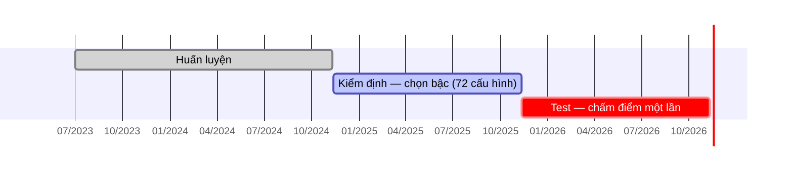

# Cách hoạt động của mô hình SARIMA

Tài liệu giải thích **từng bước** mô hình SARIMA(2,0,1)(1,1,1)₇ biến lịch sử Pmax thành một con số dự báo: công thức, cách ước lượng, cách dự báo, và **ba ví dụ tính tay trên ngày thật** của tập test. Các con số được tính lại bằng đúng mô hình đã dùng trong backtest và **khớp với `data/sarima_backtest.csv`**.

Kết quả và đánh giá: [`SARIMA.md`](SARIMA.md). So sánh với mô hình chính: [`Comparison.md`](Comparison.md). Mã nguồn: [`sarima.py`](../sarima.py).

> **Cách xem:** công thức viết bằng LaTeX, sơ đồ viết bằng Mermaid. Trên GitHub hiển thị đầy đủ. Trong VS Code nhấn `Ctrl+Shift+V`; để xem sơ đồ cần extension *Markdown Preview Mermaid Support*.

## Mục lục

1. [Tổng quan](#1-tổng-quan)
2. [Toán tử trễ và sai phân](#2-toán-tử-trễ-và-sai-phân)
3. [Mô hình SARIMA tổng quát](#3-mô-hình-sarima-tổng-quát)
4. [Mô hình đã chọn: SARIMA(2,0,1)(1,1,1)₇](#4-mô-hình-đã-chọn-sarima201111)
5. [Ước lượng tham số](#5-ước-lượng-tham-số)
6. [Dự báo 2 bước và khoảng dự báo](#6-dự-báo-2-bước-và-khoảng-dự-báo)
7. [Các kiểm định thống kê](#7-các-kiểm-định-thống-kê)
8. [Chọn bậc và quy trình walk-forward](#8-chọn-bậc-và-quy-trình-walk-forward)
9. [Ví dụ 1: Ngày lễ Quốc khánh 02/09/2026](#9-ví-dụ-1-ngày-lễ-quốc-khánh-02092026)
10. [Ví dụ 2: Hai ngày sau kỳ nghỉ, 04/09/2026](#10-ví-dụ-2-hai-ngày-sau-kỳ-nghỉ-04092026)
11. [Ví dụ 3: Ngày nắng nóng 24/06/2026](#11-ví-dụ-3-ngày-nắng-nóng-24062026)
12. [Tóm tắt cơ chế](#12-tóm-tắt-cơ-chế)

### Bảng ký hiệu

| Ký hiệu | Ý nghĩa |
|---|---|
| $y_t$ | Pmax thực tế ngày $t$ (MW) |
| $\hat y_t$ | Pmax dự báo cho ngày $t$ |
| $w_t$ | Sai phân mùa: $w_t = y_t - y_{t-7}$ (chênh lệch so với cùng thứ tuần trước) |
| $\varepsilon_t$ | Nhiễu (phần không dự báo được) của ngày $t$ |
| $B$ | Toán tử trễ: $B y_t = y_{t-1}$ |
| $\phi_1, \phi_2$ | Hệ số tự hồi quy (AR) ngắn hạn |
| $\theta_1$ | Hệ số trung bình trượt (MA) ngắn hạn |
| $\Phi_1$, $\Theta_1$ | Hệ số AR và MA **mùa** (chu kỳ 7 ngày) |
| $\sigma^2$ | Phương sai của nhiễu $\varepsilon_t$ |

---

## 1. Tổng quan

SARIMA dự báo Pmax **chỉ từ lịch sử của chính Pmax**. Mô hình không biết ngày lễ, không biết thời tiết.

| | Mô hình chính (Ridge + LightGBM) | SARIMA |
|---|---|---|
| Đầu vào | Lịch sử Pmax, lịch, nhiệt độ dự báo (27 đặc trưng) | **Chỉ** lịch sử Pmax |
| Ý tưởng | Học quan hệ giữa đặc trưng và tỉ lệ so với baseline | Học cách chuỗi Pmax **tự lặp lại** theo ngày và theo tuần |

---

## 2. Toán tử trễ và sai phân

**Toán tử trễ** $B$ dời chuỗi lùi một ngày. Dời $k$ ngày thì viết $B^k$:

$$
B y_t = y_{t-1}, \qquad B^k y_t = y_{t-k}
$$

**Sai phân** là lấy hiệu giữa hai thời điểm, dùng để loại bỏ xu hướng hoặc mùa vụ:

| Loại | Công thức | Ý nghĩa |
|---|---|---|
| Sai phân bậc 1 | $(1 - B)\thinspace  y_t = y_t - y_{t-1}$ | Chênh lệch so với hôm qua |
| **Sai phân mùa** (chu kỳ 7) | $(1 - B^7)\thinspace  y_t = y_t - y_{t-7}$ | **Chênh lệch so với cùng thứ tuần trước** |

Mô hình đã chọn chỉ dùng **sai phân mùa** ($d = 0$, $D = 1$): kiểm định ADF và KPSS cho thấy chuỗi Pmax đã dừng quanh xu hướng, không cần sai phân bậc 1 ([`SARIMA.md`](SARIMA.md) mục 3.2).

---

## 3. Mô hình SARIMA tổng quát

SARIMA(p, d, q)(P, D, Q)ₛ viết gọn bằng toán tử trễ:

$$
\phi(B) \thinspace \Phi(B^s) \thinspace (1 - B)^d \thinspace (1 - B^s)^D \thinspace y_t
\enspace =\enspace 
\theta(B) \thinspace \Theta(B^s) \thinspace \varepsilon_t
$$

| Thành phần | Đa thức | Ý nghĩa |
|---|---|---|
| AR ngắn hạn, bậc $p$ | $\phi(B) = 1 - \phi_1 B - \cdots - \phi_p B^p$ | Hôm nay phụ thuộc vào vài ngày trước |
| AR mùa, bậc $P$ | $\Phi(B^s) = 1 - \Phi_1 B^s - \cdots$ | Hôm nay phụ thuộc vào cùng thứ các tuần trước |
| Sai phân | $(1 - B)^d (1 - B^s)^D$ | Loại xu hướng ($d$) và mùa vụ ($D$) |
| MA ngắn hạn, bậc $q$ | $\theta(B) = 1 + \theta_1 B + \cdots + \theta_q B^q$ | Hôm nay điều chỉnh theo sai số của vài ngày trước |
| MA mùa, bậc $Q$ | $\Theta(B^s) = 1 + \Theta_1 B^s + \cdots$ | Điều chỉnh theo sai số của cùng thứ tuần trước |
| Nhiễu | $\varepsilon_t$ | Độc lập, phân phối chuẩn, trung bình 0, phương sai $\sigma^2$ |

---

## 4. Mô hình đã chọn: SARIMA(2,0,1)(1,1,1)₇

Với $p = 2$, $d = 0$, $q = 1$, $P = 1$, $D = 1$, $Q = 1$, $s = 7$, mô hình gồm **hai tầng**.

### Tầng 1: sai phân mùa

$$
w_t = y_t - y_{t-7}
$$

$w_t$ trả lời câu hỏi: *"hôm nay cao hơn hay thấp hơn cùng thứ tuần trước bao nhiêu MW?"*

### Tầng 2: ARMA trên chuỗi $w$

$$
(1 - \phi_1 B - \phi_2 B^2)(1 - \Phi_1 B^7)\thinspace w_t = (1 + \theta_1 B)(1 + \Theta_1 B^7)\thinspace \varepsilon_t
$$

Nhân các đa thức rồi chuyển vế, ta được công thức tính trực tiếp:

$$
\begin{aligned}
w_t \enspace =\enspace & \phi_1 w_{t-1} + \phi_2 w_{t-2} + \Phi_1 w_{t-7} - \phi_1 \Phi_1 w_{t-8} - \phi_2 \Phi_1 w_{t-9} \cr
& + \varepsilon_t + \theta_1 \varepsilon_{t-1} + \Theta_1 \varepsilon_{t-7} + \theta_1 \Theta_1 \varepsilon_{t-8}
\end{aligned}
$$

| Số hạng | Ý nghĩa trực giác |
|---|---|
| $\phi_1 w_{t-1} + \phi_2 w_{t-2}$ | Nếu hôm qua, hôm kia đang **cao hơn tuần trước**, hôm nay cũng có xu hướng cao hơn (quán tính ngắn hạn) |
| $\Phi_1 w_{t-7}$ và các tích $\phi \Phi$ | Ảnh hưởng của tuần trước nữa (rất nhỏ, vì $\Phi_1 \approx 0{,}06$) |
| $\theta_1 \varepsilon_{t-1}$ | Điều chỉnh theo **cú sốc bất ngờ** hôm qua |
| $\Theta_1 \varepsilon_{t-7}$ | **Rút lại** phần bất ngờ của cùng thứ tuần trước ($\Theta_1 \approx -0{,}86$): một thứ Tư bất thường không nên kéo theo thứ Tư tuần này |

### Cộng ngược về Pmax

$$
\hat y_t = y_{t-7} + \hat w_t
$$

### Tham số (ước lượng trên toàn bộ dữ liệu đến 10/11/2026)

| $\phi_1$ | $\phi_2$ | $\theta_1$ | $\Phi_1$ | $\Theta_1$ | $\sigma$ |
|---|---|---|---|---|---|
| 0,745 | 0,094 | 0,223 | 0,054 | −0,865 | 1 815 MW |

Trong backtest, tham số được **ước lượng lại mỗi tháng**, nên mỗi ví dụ bên dưới dùng bộ tham số riêng của tháng đó.

---

## 5. Ước lượng tham số

Tham số được chọn để **làm cực đại hàm hợp lý** (maximum likelihood), tính bằng **bộ lọc Kalman**:

$$
\ell(\phi, \theta, \Phi, \Theta, \sigma^2) \enspace =\enspace  -\frac{1}{2} \sum_{t} \left[ \ln\left(2\pi F_t\right) + \frac{v_t^2}{F_t} \right]
$$

| Ký hiệu | Ý nghĩa |
|---|---|
| $v_t = y_t - \hat y_{t \mid t-1}$ | Sai số dự báo **1 bước** của ngày $t$ (dự báo lập từ ngày $t-1$) |
| $F_t$ | Phương sai của sai số đó |

Ý nghĩa: chọn tham số sao cho các dự báo 1 bước trong quá khứ **sai ít nhất** (có tính đến độ bất định).

**Ưu điểm của bộ lọc Kalman:** ngày nào thiếu số liệu (19 ngày) thì bộ lọc **bỏ qua** số hạng của ngày đó trong tổng, và vẫn cập nhật trạng thái bằng dự báo. Không cần điền giá trị giả.

Sau khi ước lượng, các sai số $v_t$ của quá khứ được dùng làm ước lượng cho nhiễu $\varepsilon_t$ khi dự báo ($\hat\varepsilon_t = v_t$).

---

## 6. Dự báo 2 bước và khoảng dự báo

### 6.1. Vì sao 2 bước?

Dự báo cho ngày $t$ được lập trong ngày $t-1$, khi EVN mới có số liệu đến ngày $t-2$. Vì vậy SARIMA phải dự báo **2 bước**: từ $t-2$ ra $t-1$, rồi ra $t$.

### 6.2. Quy tắc

1. **Bước 1 (ngày $t-1$):** áp dụng công thức ở mục 4, với $\varepsilon_{t-1} = 0$ (chưa biết, nên lấy giá trị kỳ vọng là 0). Được $\hat w_{t-1}$ và $\hat y_{t-1}$.
2. **Bước 2 (ngày $t$):** áp dụng lại công thức, trong đó $w_{t-1}$ được thay bằng **giá trị dự báo** $\hat w_{t-1}$ ở bước 1, và $\varepsilon_{t} = \varepsilon_{t-1} = 0$.
3. Cộng ngược: $\hat y_t = y_{t-7} + \hat w_t$. Vì $t - 7 \le t - 2$ nên $y_{t-7}$ luôn đã biết.

### 6.3. Khoảng dự báo 80%

Sai số của dự báo 2 bước có phương sai:

$$
\mathrm{Var} \enspace =\enspace  \sigma^2 \left(1 + \psi_1^2\right),
\qquad
\psi_1 = \phi_1 + \theta_1
$$

$\psi_1$ đo mức một cú sốc hôm nay lan sang ngày mai. Khoảng 80% (P10–P90), với 1,2816 là phân vị 90% của phân phối chuẩn:

$$
\hat y_t \enspace \pm\enspace  1{,}2816 \cdot \sigma \sqrt{1 + \psi_1^2}
$$

Mã nguồn tính chính xác các đại lượng này bằng bộ lọc Kalman. Công thức trên cho **cùng kết quả**: đã kiểm tra trên ví dụ 1 và 3, khớp đến 0,1 MW.

---

## 7. Các kiểm định thống kê

| Kiểm định | Giả thuyết H₀ | Dùng để |
|---|---|---|
| **ADF** (Augmented Dickey–Fuller) | Chuỗi có nghiệm đơn vị (không dừng) | Quyết định có cần sai phân không |
| **KPSS** | Chuỗi dừng | Kiểm tra chéo với ADF |
| **Ljung–Box** | Phần dư không tự tương quan | Kiểm tra mô hình đã "vắt hết" cấu trúc chưa |

**ADF** ước lượng hồi quy và kiểm định $\gamma = 0$:

$$
\Delta y_t = \alpha + \beta t + \gamma y_{t-1} + \sum_{i=1}^{k} \delta_i \Delta y_{t-i} + e_t
$$

**Ljung–Box** với $\hat\rho_k$ là tự tương quan mẫu của phần dư ở độ trễ $k$:

$$
Q = n(n+2) \sum_{k=1}^{h} \frac{\hat\rho_k^2}{n - k}
$$

| Kết quả trên dữ liệu | Giá trị | Kết luận |
|---|---|---|
| ADF, chuỗi gốc có xu hướng | p < 0,001 | Bác bỏ "không dừng" |
| KPSS, chuỗi gốc có xu hướng | p > 0,10 | Không bác bỏ "dừng" |
| → | | **Dừng quanh xu hướng: chọn $d = 0$** |
| Ljung–Box phần dư (h = 7 / 14) | p = 0,145 / 0,274 | Phần dư không còn tự tương quan |

---

## 8. Chọn bậc và quy trình walk-forward

1. **Gợi ý ban đầu (Box–Jenkins):** ACF của $w_t$ giảm dần, PACF có cột lớn ở độ trễ 1–2 → AR bậc 1–2. ACF có cột âm ở độ trễ 7 → MA mùa bậc 1.
2. **Lưới tìm kiếm:** $p, q \in \lbrace 0, 1, 2 \rbrace$; $d \in \lbrace 0, 1 \rbrace$; $P, Q \in \lbrace 0, 1 \rbrace$; $D = 1$: 72 cấu hình.
3. **Mỗi cấu hình** chạy walk-forward trên năm kiểm định: đầu mỗi tháng ước lượng lại tham số bằng dữ liệu đến ngày đầu tháng trừ 2, dự báo 2 bước cho từng ngày trong tháng.
4. **Chọn cấu hình có MAPE kiểm định nhỏ nhất:** SARIMA(2,0,1)(1,1,1)₇, 4,093%.
5. **Chạy một lần trên tập test** với cấu hình đó.

---

## 9. Ví dụ 1: Ngày lễ Quốc khánh 02/09/2026

> **Thứ Tư 02/09/2026, ngày lễ, ngày cuối của kỳ nghỉ 29/08 → 02/09.** Pmax thực tế: **37 835,0 MW**.
> Dự báo lập ngày 01/09, khi mới có số liệu đến hết **31/08**.

**Tham số** (mô hình tháng 9, ước lượng trên 1 138 ngày đến 30/08/2026):

| $\phi_1$ | $\phi_2$ | $\theta_1$ | $\Phi_1$ | $\Theta_1$ | $\sigma$ |
|---|---|---|---|---|---|
| 0,7131 | 0,1302 | 0,2434 | 0,0569 | −0,8575 | 1 800 MW |

Hệ số dẫn xuất: $-\phi_1 \Phi_1 = -0{,}0406$; $-\phi_2 \Phi_1 = -0{,}0074$; $\theta_1 \Theta_1 = -0{,}2087$.

**Pmax các ngày gần nhất (MW):**

| 24/08 | 25/08 | 26/08 | 27/08 | 28/08 | 29/08 | 30/08 | **31/08** |
|---|---|---|---|---|---|---|---|
| 50 317,8 | 50 872,8 | 50 601,1 | 50 897,4 | 50 862,7 | 48 680,0 | 42 460,0 | **42 101,8** |

Ngày 31/08 là ngày nghỉ hoán đổi, nên Pmax đã giảm mạnh:

$$
w_{31/08} = y_{31/08} - y_{24/08} = 42\thinspace 101{,}8 - 50\thinspace 317{,}8 = -8\thinspace 216{,}0
$$

### Bước 1: dự báo cho 01/09

| Số hạng | Hệ số | Giá trị | Đóng góp (MW) |
|---|---|---|---|
| $\phi_1 w_{t-1}$ ($w$ ngày 31/08) | 0,7131 | −8 216,0 | **−5 858,8** |
| $\phi_2 w_{t-2}$ ($w$ ngày 30/08) | 0,1302 | −176,8 | −23,0 |
| $\Phi_1 w_{t-7}$ ($w$ ngày 25/08) | 0,0569 | −893,2 | −50,9 |
| $-\phi_1 \Phi_1 w_{t-8}$ | −0,0406 | −4 291,4 | +174,3 |
| $-\phi_2 \Phi_1 w_{t-9}$ | −0,0074 | −2 498,0 | +18,5 |
| $\theta_1 \varepsilon_{t-1}$ (sốc ngày 31/08) | 0,2434 | −8 174,7 | **−1 989,5** |
| $\Theta_1 \varepsilon_{t-7}$ | −0,8575 | +846,4 | −725,9 |
| $\theta_1 \Theta_1 \varepsilon_{t-8}$ | −0,2087 | −251,1 | +52,4 |
| **$\hat w$** | | | **−8 402,9** |

$$
\hat y_{01/09} = y_{25/08} + \hat w = 50\thinspace 872{,}8 - 8\thinspace 402{,}9 = 42\thinspace 469{,}9 \text{ MW}
$$

### Bước 2: dự báo cho 02/09

Bây giờ $w$ của ngày 01/09 chưa biết, nên dùng giá trị vừa dự báo $\hat w = -8\thinspace 402{,}9$; sốc của 01/09 lấy bằng 0.

| Số hạng | Hệ số | Giá trị | Đóng góp (MW) |
|---|---|---|---|
| $\phi_1 \hat w_{t-1}$ ($\hat w$ ngày 01/09, **dự báo**) | 0,7131 | −8 402,9 | **−5 992,1** |
| $\phi_2 w_{t-2}$ ($w$ ngày 31/08) | 0,1302 | −8 216,0 | −1 069,5 |
| $\Phi_1 w_{t-7}$ ($w$ ngày 26/08) | 0,0569 | +1 290,9 | +73,5 |
| $-\phi_1 \Phi_1 w_{t-8}$ | −0,0406 | −893,2 | +36,3 |
| $-\phi_2 \Phi_1 w_{t-9}$ | −0,0074 | −4 291,4 | +31,8 |
| $\theta_1 \varepsilon_{t-1}$ (chưa biết, = 0) | 0,2434 | 0 | 0 |
| $\Theta_1 \varepsilon_{t-7}$ | −0,8575 | −118,7 | +101,8 |
| $\theta_1 \Theta_1 \varepsilon_{t-8}$ | −0,2087 | +846,4 | −176,7 |
| **$\hat w$** | | | **−6 994,9** |

$$
\begin{aligned}
\hat y_{02/09} &= y_{26/08} + \hat w = 50\thinspace 601{,}1 - 6\thinspace 994{,}9 = \boxed{43\thinspace 606{,}2 \text{ MW}} \cr
e &= \frac{43\thinspace 606{,}2 - 37\thinspace 835{,}0}{37\thinspace 835{,}0} = +0{,}153
\end{aligned}
$$

Sai số **+15,3%** (bộ lọc Kalman cho 43 606,3 MW, khớp đến 0,1 MW).

### Khoảng dự báo 80%

$$
\begin{aligned}
\psi_1 &= \phi_1 + \theta_1 = 0{,}7131 + 0{,}2434 = 0{,}9565 \cr
\text{sd} &= \sigma \sqrt{1 + \psi_1^2} = 1\thinspace 800{,}4 \times \sqrt{1{,}9149} = 2\thinspace 491{,}4 \text{ MW} \cr
\text{P10} &= 43\thinspace 606{,}2 - 1{,}2816 \times 2\thinspace 491{,}4 = 40\thinspace 413 \text{ MW} \cr
\text{P90} &= 43\thinspace 606{,}2 + 1{,}2816 \times 2\thinspace 491{,}4 = 46\thinspace 799 \text{ MW}
\end{aligned}
$$

Giá trị thực tế (37 835 MW) **nằm dưới P10**.

### Nhận xét

| Cách dự báo | Dự báo (MW) | Sai số |
|---|---|---|
| Baseline TB 4 tuần | 51 302,9 | +35,6% |
| **SARIMA** | **43 606,2** | **+15,3%** |
| Mô hình chính | 39 506,7 | +4,4% |

SARIMA **không biết** 02/09 là ngày lễ. Dự báo giảm được khoảng 7 000 MW so với tuần trước chỉ vì nó thấy **ngày 31/08 đã giảm mạnh** ($w = -8\thinspace 216$) và giả định quán tính đó tiếp diễn. Mô hình chính thì biết trước 02/09 là ngày lễ thứ 5 của kỳ nghỉ dài, nên dự báo sát hơn nhiều.

---

## 10. Ví dụ 2: Hai ngày sau kỳ nghỉ, 04/09/2026

> **Thứ Sáu 04/09/2026, ngày làm việc bình thường.** Pmax thực tế: **51 480,9 MW**.
> Dự báo lập ngày 03/09, khi mới có số liệu đến hết **02/09**, tức **ngày lễ cuối cùng**.

Cùng bộ tham số với ví dụ 1. Hai ngày gần nhất có số liệu đều là ngày lễ:

$$
\begin{aligned}
w_{01/09} &= 37\thinspace 167{,}0 - 50\thinspace 872{,}8 = -13\thinspace 705{,}8 \cr
w_{02/09} &= 37\thinspace 835{,}0 - 50\thinspace 601{,}1 = -12\thinspace 766{,}1
\end{aligned}
$$

### Bước 1: dự báo cho 03/09

| Số hạng | Giá trị | Đóng góp (MW) |
|---|---|---|
| $\phi_1 w_{t-1}$ ($w$ ngày 02/09, **ngày lễ**) | −12 766,1 | **−9 103,5** |
| $\phi_2 w_{t-2}$ ($w$ ngày 01/09, **ngày lễ**) | −13 705,8 | **−1 784,2** |
| Các số hạng mùa và MA còn lại | | −485,6 |
| **$\hat w$** | | **−11 373,3** |

$$
\hat y_{03/09} = y_{27/08} + \hat w = 50\thinspace 897{,}4 - 11\thinspace 373{,}3 = 39\thinspace 524{,}1 \text{ MW}
$$

Thực tế ngày 03/09 là 49 702,2 MW: phụ tải đã **trở lại bình thường**, nhưng SARIMA chưa biết điều đó.

### Bước 2: dự báo cho 04/09

| Số hạng | Giá trị | Đóng góp (MW) |
|---|---|---|
| $\phi_1 \hat w_{t-1}$ ($\hat w$ ngày 03/09, **dự báo**) | −11 373,3 | **−8 110,3** |
| $\phi_2 w_{t-2}$ ($w$ ngày 02/09, **ngày lễ**) | −12 766,1 | **−1 661,9** |
| Các số hạng mùa và MA còn lại | | −787,4 |
| **$\hat w$** | | **−10 559,6** |

$$
\begin{aligned}
\hat y_{04/09} &= y_{28/08} + \hat w = 50\thinspace 862{,}7 - 10\thinspace 559{,}6 = \boxed{40\thinspace 303{,}1 \text{ MW}} \cr
e &= \frac{40\thinspace 303{,}1 - 51\thinspace 480{,}9}{51\thinspace 480{,}9} = -0{,}217
\end{aligned}
$$

Sai số **−21,7%**. Khoảng 80% là 37 110 – 43 496 MW; giá trị thực tế nằm **rất xa phía trên** P90.

### Nhận xét: hiệu ứng "dư âm"

Mức giảm của kỳ nghỉ được **truyền tiếp** qua hệ số $\phi_1$: ngày lễ → dự báo 03/09 thấp → dự báo 04/09 cũng thấp. SARIMA cần thêm vài ngày số liệu bình thường mới "quên" được kỳ nghỉ. Đây là lý do SARIMA dự báo thấp khoảng 10% trong 1–2 ngày đầu sau mỗi kỳ nghỉ ([`SARIMA.md`](SARIMA.md) mục 5.6). Mô hình chính dự báo 49 280,1 MW (sai −4,3%) cho ngày này, vì nó biết 04/09 là ngày làm việc.

---

## 11. Ví dụ 3: Ngày nắng nóng 24/06/2026

> **Thứ Tư 24/06/2026, ngày Pmax kỷ lục: 57 536,7 MW.** Dự báo lập ngày 23/06, có số liệu đến hết 22/06.

**Tham số** (mô hình tháng 6, ước lượng trên 1 046 ngày đến 30/05/2026):

| $\phi_1$ | $\phi_2$ | $\theta_1$ | $\Phi_1$ | $\Theta_1$ |
|---|---|---|---|---|
| 1,8253 | −0,8285 | −0,9484 | 0,0590 | −0,8839 |

Bộ tham số này **khác hẳn** tháng 9: $\phi_1 > 1$ và $\theta_1 \approx -0{,}95$. Phần AR và MA gần như **triệt tiêu một phần** lẫn nhau (cùng có thừa số gần với $1 - 0{,}95 B$). Đây là biểu hiện của việc cấu trúc AR(2) + MA(1) **khó xác định ổn định** ([`SARIMA.md`](SARIMA.md) mục 4).

### Kết quả hai bước

| | Bước 1: 23/06 | Bước 2: 24/06 |
|---|---|---|
| Cùng thứ tuần trước $y_{t-7}$ | 51 421,2 (16/06) | 53 119,4 (17/06) |
| Đóng góp AR ngắn hạn ($\phi_1, \phi_2$) | −1 167,2 | **+2 271,3** |
| Đóng góp AR mùa (tích với $\Phi_1$) | +191,0 | −122,5 |
| Đóng góp MA ($\theta_1, \Theta_1$) | +2 131,8 | **−2 455,7** |
| **$\hat w$** | **+1 155,6** | **−306,8** |
| **$\hat y$** | 52 576,8 | **52 812,6** |
| Thực tế | 55 598,4 | **57 536,7** |

$$
e = \frac{52\thinspace 811{,}1 - 57\thinspace 536{,}7}{57\thinspace 536{,}7} = -0{,}082
$$

Sai số **−8,2%** (dùng giá trị Kalman 52 811,1 MW; phép tính tay lệch 1,5 MW do ước lượng nhiễu ở đầu chuỗi).

### Nhận xét

- SARIMA dự báo gần bằng **mức của tuần trước** (53 119 MW), vì nó không biết ngày 24/06 nóng hơn.
- Thành phần MA mùa ($\Theta_1 = -0{,}88$) **rút lại** phần tăng bất ngờ của thứ Tư tuần trước. Đây là hành vi đúng với ngày bình thường, nhưng **sai** trong đợt nắng nóng kéo dài, khi mức tăng là thật và còn tiếp diễn.
- Mô hình chính dự báo 55 233,5 MW (sai −4,0%) nhờ biết nhiệt độ dự báo cao hơn ngày tham chiếu 2,5–3,8°C ([`Algorithm.md`](Algorithm.md) mục 8).

---

## 12. Tóm tắt cơ chế

| Tình huống | SARIMA làm gì | Hệ quả |
|---|---|---|
| Ngày thường, ổn định | Lấy cùng thứ tuần trước, điều chỉnh theo xu hướng 1–2 ngày gần nhất | **Tốt** (MAPE 2,9%) |
| Ngày lễ | Không biết là ngày lễ; chỉ giảm nếu 1–2 ngày trước đã giảm | **Dự báo quá cao** (lễ/Tết 15%) |
| Ngày làm việc ngay sau kỳ nghỉ | Mang theo mức thấp của ngày nghỉ qua $\phi_1 w_{t-1}$ | **Dự báo quá thấp** ("dư âm", khoảng −10%) |
| Đợt nắng nóng | Không biết nhiệt độ; MA mùa còn kéo dự báo về mức cũ | **Phản ứng chậm 2 ngày** (nắng nóng 4,3%) |
| Độ bất định | Tính từ lý thuyết: $\sigma \sqrt{1 + \psi_1^2}$ | **Khoảng 80% đáng tin cậy** (phủ 86%) |

**Ý nghĩa:** SARIMA là một bộ "nhớ" rất tốt **cách chuỗi Pmax tự lặp lại**, nhưng mọi thay đổi đến từ **bên ngoài chuỗi** (lịch nghỉ, thời tiết) thì nó chỉ nhận ra **sau khi đã xảy ra 2 ngày**. Đó chính là phần mô hình chính bổ sung bằng đặc trưng lịch và nhiệt độ dự báo.
